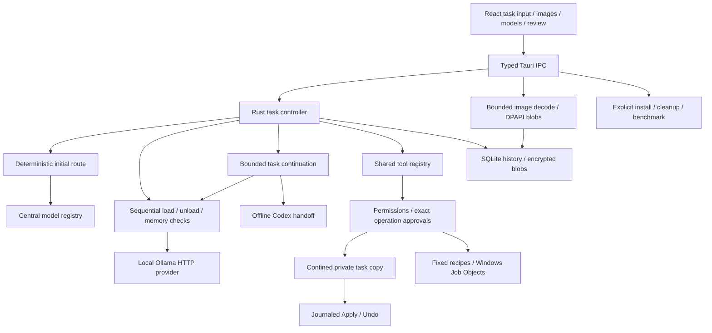

# Local Agent architecture

## 0.5.0 capabilities and MCP

The official Rust rmcp SDK owns modern/legacy protocol compatibility. `mcp.rs` owns strict integration configuration, protected credentials, discovery and connections; `mcp_http.rs` applies bounded DNS-pinned HTTP policy. `capabilities.rs` builds the native/integration catalog and selects groups. `agent_mcp.rs` brokers task acquisition, compact tool search, selected schemas and reviewed calls. Connections live in the existing task Session across local escalation and close before terminal publication. Settings uses narrow native IPC and persists safe diagnostics separately from credentials. See [decision 007](docs/decisions/007-mcp-capabilities.md) and [completed acceptance](docs/QA_0.5.0_COMPLETION.md).

## 0.4.0 browser operator

`browser_session.rs` owns the task-lived typed transport, origin grants, bounded operations and cleanup over the existing helper/Job boundary. `browser.rs` remains the Rust HTTP/DNS/IP authority and retains deterministic scenarios. `web.rs` uses that broker for anonymous static retrieval without Chromium. `dev_server.rs` supervises approved development scripts in the task copy. The existing agent Session survives local tier escalation and is closed before terminal publication.

Browser-only workspaces use an additive defaulted Project field and reject project/host tools at dispatch. Screenshots reuse `images.rs`; compact observations reuse task events, continuation and offline handoff. Navigation grants differ from public resource grants. Static form submission is a separate exact-request approval. Task termination awaits browser/server cleanup and removes temporary browser HOME; interrupted-task reconciliation repeats profile cleanup. See [decision 006](docs/decisions/006-browser-operator.md), [supported boundaries](docs/BROWSER_OPERATOR.md) and [QA](docs/QA_0.4.0.md).

The Windows application remains Tauri 2, React/TypeScript and a Rust authority core, using Ollama's native loopback API. [HANDOFF.md](HANDOFF.md) is the original baseline; [decision 003](docs/decisions/003-multimodal-continuation.md) supersedes its model, context and escalation rules. It does not replace the filesystem, permission, snapshot or process boundaries.

## Ownership of decisions

- `assets/model-registry.json`: the three default physical identities, quantization, display text, preferred contexts, capabilities and expected placement. Installed capabilities come from Ollama metadata; registry descriptions do not override missing runtime support.
- `src-tauri/src/registry.rs`: registry parsing, tier context selection and non-destructive settings migration. Arbitrary custom assignments remain intact.
- `models.rs`: selects a verified, installed local model. Strong additionally needs an enabled profile and a passing digest/runtime/context-matched coding benchmark. Full GPU residency is **not** required.
- `lifecycle.rs` and the controller's activation/release methods: system-memory observations, conservative allocation preflight, sequential transitions and sustained low-memory detection. Unrelated loaded Ollama models are preserved and block loading another tier.
- `continuation.rs`: builds bounded evidence from the existing task; it neither grants permissions nor persists hidden reasoning. `agent.rs` decides when a deterministic escalation signal is sufficient and retains global budgets.
- `images.rs`: validates and normalizes inert image inputs, stores encrypted source/normalized bytes once, provides bounded previews and assembles transient Ollama `images` payloads. Task history holds references, not base64 copies.
- `model_management.rs`: explicit installation and cleanup operations. Download progress is a service record. Ownership is established by a matching installation receipt, not by a model-name guess.
- Existing `security`, `fs`, `commands`, `snapshots` and `browser` modules retain their authority. New models never receive a different or more permissive tool harness.

## Persistence and compatibility

Additive task fields use Serde defaults: structured inputs, frozen escalation preference, stage history, continuation and metrics. Existing task, approval, snapshot and journal records remain readable. The generic SQLite record schema and encrypted blob format are unchanged. Old global context/model fields remain for compatibility; normal inference uses per-tier context settings.

An in-task tier transition keeps the same task ID, snapshot, working files, check records, grants, denied operations and remaining limits. An explicit **Continue task** remains a new user-started task, as before. On restart, interrupted tasks do not resume commands or approvals automatically.

The original 0.3 update introduced no cloud inference, cloud model subscription, automatic external image transmission, browser operator, desktop controller, MCP ecosystem or background autonomy. The browser operator was added in 0.4 as described above.

## 0.3.1 stabilization

[Decision 005](docs/decisions/005-conversational-outcomes.md) defines the interaction and terminal-result contracts. `interaction.rs` separates Converse/Inspect/Execute from model selection. Explicit constraints, project/prior-task context and a bounded optional local classification feed intent-specific prompts and schemas. `agent_tools.rs` enforces intent again at dispatch, alongside existing permissions.

The controller publishes `TaskResult` after cleanup on success, failure, escalation or cancellation; restart reconciliation supplies interrupted results. `Task::transition` records lifecycle edges and unexpected-edge diagnostics. The frontend renders the result separately from Activity, with a terminal fallback and allowlisted Copy diagnostics. See the decision for transition edges, failure semantics and the host-code limitation on diagnostic commands.
