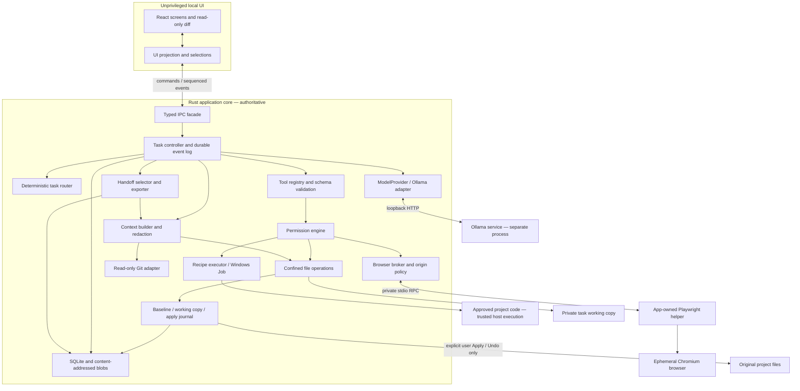
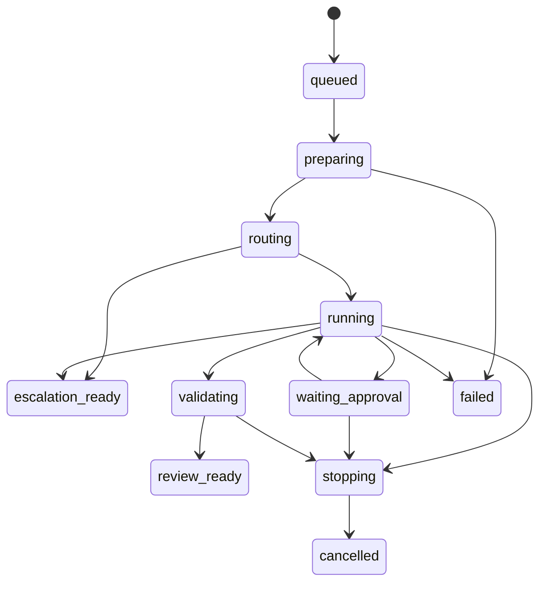

# Local Agent — Architecture and Implementation Handoff

Architecture baseline: 2026-10-16. Working product name: **Local Agent**.

Implementation update: model lineup, contexts, partial-offload policy, in-task escalation and image inputs are superseded by [decision 003](docs/decisions/003-multimodal-continuation.md). The current implementation map is [ARCHITECTURE.md](ARCHITECTURE.md). Filesystem, permission, snapshot and recovery boundaries below remain the baseline.

This file is the architect's deliverable for the implementation agent. It is not an application-generated escalation handoff. The repository was inspected: it contains only an unborn Git repository, with no application source, dependencies, or existing implementation to preserve. No application was implemented during this architecture task.

**Build a Windows desktop tool that prepares small, reviewable coding changes using local inference. Protect the user's working files, make execution understandable, and stop when the task exceeds the tool's competence.**

Normative language: MUST is a release requirement; SHOULD is a default that can change with documented evidence. Numeric limits below are initial product settings, not empirical model benchmarks. Sources and research limitations are recorded near the end.

## 1. Product definition

### Audience and promise

A programmer on Windows with an RTX 4070 Super (12 GB VRAM) and i5-12400F wants to delegate repetitive work without managing a terminal. System RAM is unknown; do not assume 32 GB. The application should reduce cloud-agent usage for bounded tasks, not promise frontier-level architectural reasoning.

The central object is a **task with evidence and proposed changes**, not an endless chat. The user can always answer: which project, which model, what permission, what is happening, what changed, what was verified, and how to recover.

### Primary workflows

1. Add project → inspect without running project code → select local model → submit task.
2. Route task → create private task working copy → run deterministic steps first → obtain required approvals → bounded local agent work → review proposed diff and validation → **Apply changes**.
3. After applying → keep working in existing editor → **Undo applied changes** only where the current files still match the applied version; conflicts never overwrite newer work.
4. Failed or oversized task → stop with useful evidence → **Prepare for Codex** → preview selected/redacted context → export or copy. Nothing is uploaded automatically.
5. Optional browser capability → check a local app, perform bounded test interactions, or inspect public documentation → record results alongside file/test actions. Browser use alone is not an escalation reason.

### Non-goals

No full IDE, general terminal emulator, unrestricted shell agent, cloud-account integration, automatic cloud spending, background autonomous maintenance, Git client replacement, multi-agent orchestration, remote agents, vector database, or reliable execution of hostile projects on the host. No claim that tests passing proves correctness or that an LLM can judge security reliably.

### MVP supported project envelope

Windows 11 x64, local fixed NTFS volume, ordinary directories, Git optional. Fully supported execution adapters: Node/npm projects (JavaScript/TypeScript) and Python projects with an existing interpreter/environment. Other stacks get file/search/edit/review/handoff, with command support explicitly unavailable until an adapter is added. No silent fallback to a shell.

Reject writable projects on UNC/network shares, removable volumes, cloud-placeholder/reparse roots, case-sensitive directories, or unresolved links. Explain how to choose a local ordinary folder. Git submodules and nested repositories are excluded boundaries; select them separately. Do not recurse into them automatically. Large monorepos may be opened at a package directory; display the selected scope and enclosing Git root separately.

## 2. Architecture decisions

### Locked decisions

| Area | Decision | Reason |
|---|---|---|
| Desktop | Tauri 2 + React + TypeScript + Vite | Small desktop shell, native dialogs, explicit Rust boundary; Windows WebView2 rather than shipping another Chromium for the normal UI |
| Authority | Rust application core | Files, policy, task state, inference, command launch, snapshots, persistence never belong in the renderer |
| Local inference | Ollama native HTTP API initially | Simple user installation, model discovery, streaming and tool support; provider adapter keeps runtime replaceable |
| Editing | Independent task working copy + content-addressed baseline + journaled apply/undo | Same semantics for clean Git, dirty Git, and non-Git; no stash/reset/branch surprises |
| Execution | Typed command recipes; explicit host-code trust | Command names and arguments alone cannot sandbox project code |
| State | SQLite in application data + blob files | Transactional task/approval/journal metadata; large bytes outside DB |
| Retrieval | Filename and bounded text search, manifest inspection | Predictable, transparent, cheap; no embeddings required |
| Browser | Optional Node/Playwright helper with fixed RPC vocabulary | Mature browser automation without exposing JavaScript execution to the agent |
| Concurrency | One active task globally; one proposed change set per project | Fits one local GPU and makes consistency/recovery manageable |

Tauri capabilities constrain renderer access; they do not implement this product's per-task permissions. Custom Rust commands MUST enforce policy. Tauri documents both its core/frontend boundary and capability behavior; do not assume registering an IPC handler automatically restricts it. [Tauri security](https://v2.tauri.app/security/), [capabilities](https://tauri.app/security/capabilities/).

### Dependency choices

- UI: React, TypeScript strict mode, Vite, Tailwind CSS with semantic CSS variables, individually added shadcn/Radix primitives for dialogs/menus/tabs, Lucide icons, Zustand for local UI selections and the event projection. No broad UI suite, animation library, or separate state machine framework.
- Diff: lazy-load Monaco **diff editor only**, read-only, packaged workers served locally. It supplies a familiar side-by-side/unified review without building an editor. Plain-text fallback for oversized files; no full IDE services.
- Rust: `tauri`, `serde`/`serde_json`, `tokio`/`tokio-util`, `reqwest` with explicit redirect/proxy behavior, `rusqlite` with bundled SQLite, `sha2`, `uuid`, `thiserror`, `ignore`, `regex`, `similar`, `windows`, `tracing`. Use `schemars` for tool schemas and `ts-rs` for IPC types; serialized contracts have snapshot tests. Keep dependency features minimal.
- Search: Rust `ignore` walker + bounded literal/linear-time Rust regex search; no ripgrep binary required in the shipped app. A later measured replacement with bundled ripgrep is allowed.
- Browser helper: pinned `playwright-core`, app-owned Node runtime and matching Chromium payload installed as an optional component. Never import helper code from the selected repository. No Python browser runtime or public CDP port.
- Tests: Rust unit/integration tests, Vitest + React Testing Library, Playwright for UI against a fake backend plus Windows packaged-app smoke tests.

Pin actual stable versions and commit both lockfiles when bootstrapping. This document intentionally specifies compatible major technologies rather than inventing future patch versions. Do not add LangChain, generic agent frameworks, Docker, GSAP, Lenis, or React Bits for this desktop MVP. CSS state transitions are sufficient; the requested website-animation tools remain appropriate for future substantive website motion, not this utility.

### Alternatives rejected

- Electron: easier all-TypeScript Playwright integration, but ships a larger default runtime and makes it tempting to place policy in loosely separated JavaScript. Viable if the Rust/Windows spike fails, but changing stacks requires preserving the exact security and recovery contracts.
- WinUI/.NET: strong Windows APIs but a less portable UI and a different implementation skill profile; no decisive benefit over a narrow Rust Windows adapter.
- Pure browser/PWA: unsuitable for reliable local process control and filesystem recovery.
- llama.cpp/LM Studio: potentially useful later; no demonstrated first-version advantage sufficient to offset runtime setup/support. Do not integrate several providers at once.
- Git worktrees as the sole recovery mechanism: do not naturally preserve dirty/untracked state, require Git, and add index/branch complexity. Git remains read-only context in v1.
- In-place editing plus `git reset`/stash: rejected; can destroy or mingle pre-existing changes.

### Distribution

Target an NSIS user installer with WebView2 bootstrap support and a portable developer build. Do not require administrator execution. Bundle app-owned helpers under a read-only install directory where practical; verify installed helper hashes before launch. Runtime/model installation is guided, not silent. v1 checks for app updates only on user request and opens an official download page; signed unattended updates are deferred. Never ship a custom unsigned auto-update downloader.

## 3. System architecture and trust boundaries



**Data planes:** source content, logs, web pages and model text are untrusted data. They cannot mint grants or call executors. The UI can request actions, but Rust validates identities, state and authority. The model sees opaque task-scoped handles, never an arbitrary executor endpoint.

No remote page loads in the privileged Tauri WebView. Render Markdown without raw HTML, remote images, inline scripts, or executable links. Diff and log contents are text. Browser screenshots are displayed as local inert images. Set a restrictive CSP with no remote script sources; narrowly permit packaged workers needed by Monaco. No renderer filesystem/shell plugins. Native picker results are registered in Rust; arbitrary strings supplied by renderer/model are not project authorization.

## 4. Intended repository structure

```text
HANDOFF.md                       this design; keep as implementation reference
README.md                        user setup and developer prerequisites
package.json / package-lock.json frontend and development scripts
src/
  app/                           shell, routes, keyboard shortcuts, error boundary
  features/projects/             folder selection and project trust setup
  features/tasks/                input, activity, task outcome and continuation
  features/review/               file list, diff, Apply/Undo and conflicts
  features/models/               runtime connection, model picker and diagnostics
  features/permissions/          approvals and command-recipe management
  features/browser/              optional browser session, action preview/results
  features/handoffs/              content selection, redaction preview/export
  components/ui/                 small accessible reusable controls
  state/                         event projection; no policy decisions
  lib/ipc.ts                     only frontend-to-core gateway
  generated/                     generated Rust IPC types; never hand-edit
  styles/                        semantic theme variables and typography
src-tauri/
  capabilities/main.json         minimal trusted window capabilities
  src/lib.rs                     composition root; no business logic
  src/ipc/                       narrow commands, typed envelopes, window checks
  src/domain/                    IDs, errors, task and approval states
  src/agent/                     controller, budgets, progress fingerprints
  src/providers/                 trait, Ollama NDJSON adapter, fake provider
  src/context/                   selection, bounded excerpts, provenance, budget
  src/router/                    pure heuristic decisions and reason codes
  src/tools/                     schema registry and typed dispatch
  src/policy/                    grants, scopes, risk and hard-deny decisions
  src/fs/                        Windows path handles, reads, edits, content hashes
  src/commands/                  adapters, immutable recipes, process supervision
  src/snapshots/                 copy manifest, blobs, apply/undo WAL and recovery
  src/git/                       read-only status, index fingerprint and metadata
  src/browser/                   helper lifecycle, policies, fixed HTTP fetch broker
  src/handoff/                   deterministic selection, sanitization, export
  src/store/                     SQLite migrations, queries, artifact lifecycle
  src/platform/windows/          file handles, volume checks, Job Objects, DPAPI
  tests/                         Windows filesystem/process/crash integration tests
browser-helper/
  package.json / package-lock.json independent optional helper dependencies
  src/main.ts                    framed stdio RPC; fixed action dispatch
  src/session.ts                 isolated contexts and cancellation
  src/observe.ts                 bounded accessible DOM snapshot and element refs
  src/network.ts                 route all HTTP through core broker; fail closed
fixtures/                        synthetic repos, malicious paths, test websites
tests/ui/                        fake-backend end-to-end product flows
docs/decisions/                  evidence-backed departures from this baseline
```

Create only modules needed for the phase being implemented. Do not scaffold empty abstractions for deferred providers/stacks. A module may start as one file. Domain code MUST be testable without launching Tauri.

## 5. Core contracts

The following TypeScript notation defines the wire semantics; implement corresponding Rust types as the authority and generate TypeScript. All wire objects have schemaVersion 1 at the outer IPC/storage boundary. IDs are opaque UUIDs. Hash means SHA-256 of exact bytes unless explicitly called a normalized fingerprint. Paths are relative slash-separated logical paths, validated in Rust.

```ts
type Id = string;
type Hash = string;
type RelPath = string;
type Mode = 'observe' | 'assisted' | 'project';
type TaskState = 'queued' | 'preparing' | 'routing' | 'running'
  | 'waiting_approval' | 'validating' | 'stopping' | 'review_ready'
  | 'escalation_ready' | 'failed' | 'cancelled' | 'interrupted';
type ChangeState = 'none' | 'proposed' | 'applying' | 'applied'
  | 'discarded' | 'undoing' | 'undone' | 'conflict' | 'recovery_required';

interface Project {
  id: Id; displayName: string; displayPath: string;
  rootIdentity: { volumeId: string; fileId: string }; // native identity, not path prefix
  git?: { rootDisplayPath: string; head?: string; unborn: boolean };
  stack: 'node' | 'python' | 'other'; mode: Mode;
  trust: 'untrusted' | 'host_code_approved';
  configRevision: number; lastOpenedAt: string;
}
interface AgentTask {
  id: Id; projectId: Id; request: string; state: TaskState;
  changeState: ChangeState; revision: number; eventSeq: number;
  mode: Mode; route: RouteDecision; modelDigest?: string;
  snapshotId?: Id; budget: Budget; usage: Usage;
  parentTaskId?: Id; outcome?: Outcome;
}
interface RouteDecision {
  level: 0 | 1 | 2 | 3 | 4; score: number;
  reasons: string[]; strategy: 'recipe' | 'fast' | 'balanced' | 'handoff';
  estimatedFiles: number | null; confidence: 'bounded' | 'uncertain';
}
interface Budget {
  turns: number; tools: number; commands: number; browserActions: number;
  activeSeconds: number; generatedTokens: number; changedFiles: number;
}
interface Usage { turns: number; tools: number; commands: number;
  browserActions: number; activeSeconds: number; generatedTokens: number }
interface Outcome {
  kind: 'completed' | 'partial' | 'blocked' | 'failed'; summary: string;
  claims: { text: string; evidenceIds: Id[] }[];
  validation: ValidationResult[]; warnings: string[];
}
interface AgentEvent {
  taskId: Id; seq: number; timestamp: string;
  kind: 'state' | 'activity' | 'tool_started' | 'tool_finished'
    | 'approval' | 'validation' | 'changes' | 'warning' | 'usage';
  payload: EventPayload; // implement as a tagged union, never arbitrary rendered HTML
}
interface ToolCall { id: Id; name: string; arguments: unknown }
interface ToolDefinition {
  name: string; description: string; inputSchema: object;
  effect: 'read' | 'edit' | 'execute' | 'browser';
  // Rust methods, not values supplied by model:
  // validate(args), plan(args, context), execute(validatedPlan, authorization)
}
interface ToolResult {
  callId: Id; status: 'ok' | 'error' | 'denied' | 'cancelled';
  code?: string; data: unknown; artifactId?: Id;
  truncated: boolean; bytesTotal?: number;
  provenance: { source: string; hash?: Hash; lines?: [number, number] }[];
}
interface PermissionRequest {
  id: Id; taskId: Id; operationHash: Hash; policyRevision: number;
  summary: string; risk: string; scope: PermissionScope;
  previewArtifactId?: Id; expiresAt: string;
  allowedChoices: ('once' | 'task' | 'deny')[];
  state: 'pending' | 'approved' | 'denied' | 'expired' | 'invalidated' | 'consumed';
}
interface CommandRecipe {
  id: Id; projectId: Id; kind: 'test' | 'lint' | 'format' | 'build' | 'dev_server';
  adapter: 'node' | 'python'; executableIdentity: Hash;
  fixedArgs: string[]; workingSubdir: RelPath;
  configDigest: Hash; dependencyDigest: Hash;
  timeoutSeconds: number; approvedRevision?: number;
}
interface FileVersion { hash: Hash; size: number; encoding: 'utf8' | 'utf8-bom' | 'opaque' }
interface FileDelta {
  path: RelPath; before: FileVersion | null; after: FileVersion | null;
  origin: 'agent_tool' | 'command' | 'user_resolution';
}
interface Snapshot {
  id: Id; taskId: Id; rootIdentity: Project['rootIdentity'];
  baselineManifestHash: Hash; workingRevision: number;
  excluded: { path: RelPath; reason: string }[];
  gitHead?: string; gitIndexHash?: Hash; state: ChangeState;
}
interface ValidationResult {
  id: Id; recipeId: Id; workspaceRevision: number; manifestHash: Hash;
  startedAt: string; exitCode: number | null;
  status: 'passed' | 'failed' | 'timed_out' | 'cancelled' | 'not_run' | 'stale';
  counts?: { passed: number; failed: number; skipped: number };
  evidenceArtifactId: Id; parser: string | null;
}
interface ModelInfo {
  providerId: string; name: string; digest: string; bytesOnDisk: number;
  parameterSize?: string; quantization?: string; advertisedContext?: number;
  configuredContext: number; toolCapability: 'unknown' | 'advertised' | 'verified' | 'failed';
  availability: 'installed' | 'missing'; loaded: boolean;
  observedVramBytes?: number; capabilityProbeVersion?: number;
}
interface ModelProvider {
  health(signal: AbortSignal): Promise<ProviderHealth>;
  listModels(signal: AbortSignal): Promise<ModelInfo[]>;
  inspectModel(name: string, signal: AbortSignal): Promise<ModelInfo>;
  chat(request: ChatRequest, signal: AbortSignal): AsyncIterable<ProviderChunk>;
}
interface HandoffPackage {
  id: Id; taskId: Id; createdAt: string; schemaVersion: 1;
  baselineHash: Hash; workingHash: Hash; changesApplied: boolean;
  included: { relativePath: string; sha256: Hash; bytes: number }[];
  omissions: { reason: string; count: number }[];
  requiresManualReview: boolean; exportedPath?: string;
}
interface BrowserSession {
  id: Id; taskId: Id; profile: 'public_read' | 'local_test';
  allowedOrigins: string[]; documentRevision: number;
  state: 'starting' | 'ready' | 'waiting_approval' | 'closed' | 'failed';
}
```

Additional contract rules:

- `PermissionScope` is a tagged union of exact edit-set hashes, recipe IDs/config digests, or browser origin/action/element/document revisions. No untyped wildcard strings.
- `ChatRequest` contains typed role messages, selected tool schemas, context/output budgets, model digest/name and supported options. `ProviderChunk` distinguishes content, provider thinking (ephemeral), tool calls, usage and terminal/error. Preserve provider-required tool-call correlations internally.
- Rust internal `ExecutionPlan` contains resolved handles/identities, input hashes, resource effects and a nonce. Only the policy engine can construct an `AuthorizedPlan`; executors accept that type, never raw model arguments.
- IPC: `add_project_from_picker`, `inspect_project`, `start_task`, `cancel_task`, `answer_approval`, `get_task`, `get_events(afterSeq)`, `get_diff`, `apply_changes(expectedRevision)`, `undo_changes`, `discard_changes`, `list_models`, `probe_model`, `create_handoff_preview`, `export_handoff`. UI actions carry expected task revision and idempotency key. No public `exec`, `write_any_file`, or `approve_all` IPC.
- Publish events after the corresponding DB transaction commits. Subscribe then fetch state/events, deduplicate by sequence; reconnects must not duplicate actions. UI projection may lag but never grants authority.
- UI-to-core messages also include a schema version and window identity check. The main window alone may answer approvals or Apply/Undo. Internal tool dispatch is not exported as a Tauri command. Generate IDs and evidence references in the core; never accept model-invented evidence as a stored record.

## 6. Bounded agent loop

Default task budget: 16 inference turns, 40 total tool calls, 6 command launches, 30 browser actions, 12 minutes active time, 16,000 generated tokens across turns, 12 changed files, 1 MiB cumulative changed source bytes. Per-response output cap: 2,048 tokens. At most four proposed calls per response, executed sequentially. Larger work requires a new user-started task, not automatic budget resets.

Approval waiting does not consume active execution time. Each approval expires after 15 minutes. A task may remain visible afterward but must re-plan/revalidate before continuing. Cancel is available during every wait, copy, network request and command.

```text
start_task(projectId, userRequest, selectedPreset, mode, expectedProjectRevision):
  acquire global active-task permit and project task lease
  persist task + initial budget; all later transitions durable
  validate project identity and supported filesystem
  inspect bounded manifests and file index without executing anything
  derive route from user request + deterministic evidence
  if L4: create evidence-only escalation draft; finish escalation_ready
  if writes/commands/browser-local-server needed:
    capture stable baseline and private working copy; fail before work if incomplete
  else:
    use confined original read view with hashes; no snapshot needed for pure reading
  choose recipe or verified tool-capable installed model
  if L0: execute typed deterministic workflow through SAME policy/executor
  otherwise loop:
    check cancellation, budgets, capability changes, source/workspace invalidations
    build bounded context with immutable user task, constraints, evidence and ledger
    request one model response with cancellation + stream limits
    accumulate complete assistant message; never execute partial tool JSON
    validate terminal marker, call count, names, schemas and size limits
    if invalid: return one small protocol error; max 2 repairs per task
    persist assistant result after sanitization; don't persist raw thinking
    if no tool calls:
      treat text as proposed completion, not proof; break to validation
    for each call, in order:
      increment counters BEFORE attempting execution (denied attempts count)
      canonicalize arguments; detect repeated action fingerprints
      plan effects using trusted code; check root/path/version/resource identities
      ask policy: deny | allow authorized plan | request user approval
      if approval:
        suspend; show concrete effects and trust requirements
        on decision, revalidate plan hashes/policy/task revision
        if changed, invalidate approval and produce a fresh preview
      execute exactly once using operation ID and cancellation token
      journal mutations and capture result/evidence
      sanitize/bound result before model ingestion and persistent activity log
      append tool response to matching assistant call (including denial/error)
      recompute manifest after commands; invalidate stale validation results
    update progress fingerprint and route floor; stop on exhaustion/escalation rule
  validation:
    stop dev servers and background children; reconcile working manifest
    run approved final validation recipes if budget permits
    derive outcomes from actual tool records, not model assertions
    freeze proposed manifest/diff; attach validation revision + environment facts
    review_ready (including partial results), or escalation_ready with preserved diff
  finally:
    release active permit; expire outstanding grants; close browser; preserve evidence
```

Progress = changed source hash, new relevant evidence hash, or changed validation fingerprint. Repeating the same read/search without new file content twice returns cached output; the third request is `NO_PROGRESS`. Two identical failing validations on the same manifest stop repair attempts. Three turns without progress stop. Two malformed responses total stop with model-compatibility guidance. Two provider failures stop; retry an inference only if no tools from it executed, at most once with 1-second backoff. Never replay a command after an ambiguous disconnect.

Check changed-file/byte budgets against the planned post-edit manifest before an edit. Commands can change more than predicted: reconcile afterward, stop the task and quarantine an over-budget proposal for review/export; never silently truncate its diff or apply only the first files. Generation accounting includes provider thinking where reported. If token usage is unavailable, enforce byte and wall-time bounds rather than treating usage as zero.

No hidden chain-of-thought in the UI or audit history. Display short action explanations and recorded outcomes. Provider thinking needed for a tool follow-up stays in bounded in-memory provider transcript; discard on task end and never export it.

Cancellation: transition to stopping immediately; abort HTTP, reject pending approvals, kill command Job, close browser context/helper when appropriate. Await child exit, then reconcile files. Never auto-apply or automatically discard on cancellation. If an apply/undo transaction is underway, finish or recover that transaction before reporting a stable state; Cancel cannot mean abandoning half a write.

Continue before Apply: create a new task record linked to the previous task, reuse the same immutable baseline and working copy after validating it, with fresh explicit budgets. Old review revision becomes superseded. Continue after Apply: capture a new baseline from current project. Never allow two independent pending working copies to be applied blindly over one another.

## 7. Tool registry

Every schema rejects unknown properties, absolute paths, oversized strings and excessive array lengths. Model arguments never contain project root, task ID, executable path, environment map, or raw browser JavaScript; these come from trusted context.

| Tool | Arguments and output | Policy / validation / risk |
|---|---|---|
| `inspect_project` | `{}` → stack, bounded tree, manifest summaries, available recipe IDs, exclusions | Read; no scripts, no package-manager invocation; manifest fields are data |
| `list_directory` | `{path, cursor?}` → max 200 entries and next cursor | Read; confined root, no link traversal, stable sorted order |
| `search_files` | `{pattern}` → max 100 relative filenames | Read; bounded glob grammar; no shell glob expansion |
| `search_text` | `{query, paths?, regex?:boolean}` → max 100 matches with line ranges/hashes | Read; query ≤512 chars; Rust regex only; 5-second deadline; secret exclusions |
| `read_file` | `{path,startLine?,lineCount?}` → excerpt, encoding, full-byte hash, total lines | Read; max 200 lines/24 KiB per call; text eligibility and redaction enforced |
| `apply_patch` | `{path,expectedHash,hunks:[{oldText,newText}]}` → new hash and diff summary | Edit in working copy only; ≤16 hunks, ≤64 KiB payload; each oldText nonempty and matches exactly once; all hunks evaluated against same version, reject overlaps; preserve untouched bytes |
| `create_file` | `{path,content}` → new hash | Edit; CREATE_NEW; ≤128 KiB; UTF-8; no overwrite; directories created individually by confined executor |
| `delete_file` | `{path,expectedHash}` → tombstone | Always approve; one ordinary file only; never recursive; protect config/secret/internal paths |
| `run_tests` | `{recipeId,selectionId?}` → exit, parsed counts if supported, log artifact | Host-code trust + approved recipe; selection IDs created by adapter from known tests, not arbitrary flags |
| `run_linter` | `{recipeId,fix:boolean}` → diagnostics, log, observed changes | Host-code trust; fix flag must map to an approved recipe variant; auto-fix can edit files |
| `run_project_command` | `{recipeId}` → typed execution result | Only app-registered test/lint/format/build/dev-server recipes; no command text |
| `git_status` | `{}` → original branch/head and staged/unstaged/untracked summary | Read-only adapter; clarify original vs proposed state; no model Git arguments |
| `git_diff` | `{scope:'proposed'|'existing',path?}` → bounded diff artifact | Proposed diff from baseline blobs; existing user diff separately labeled and redacted |
| `browser_open` | `{url,profile}` → session/page IDs and observation | Optional capability; origin approval, fixed profiles, no persistent user browser |
| `browser_observe` | `{pageId}` → visible text, role/name refs, URL, document revision | Max 200 refs/12 KiB; omit hidden/password/input values; untrusted page text |
| `browser_act` | `{pageId,revision,ref,action,value?}` → updated observation/result | Action enum click/fill/select/check/press; exact refs, allowed keys, policy below |
| `browser_check` | `{pageId,check}` → deterministic assertion evidence | Check enum text-visible/element-visible/title/url; bounded waits; no arbitrary expression |
| `browser_capture` | `{pageId}` → local screenshot artifact ID | User-visible screenshot, excluded from export by default; never decode screenshot into code execution |
| `finish_task` | `{summary,evidenceIds,unresolved}` → completion request | Controller validates evidence; does not grant success or bypass final checks |
| `request_escalation` | `{reason,evidenceIds}` → escalation draft | Cannot upload; deterministic packaging only |

No generic `write_file` for existing files in v1: whole-file replacement is a common small-model failure. No fuzzy patch application. Rename is an approved create+delete pair shown as such; case-only rename is unsupported in v1. No `eval`, `python -c`, PowerShell, shell tool, arbitrary HTTP request, filesystem upload, or model-defined script execution.

Initially expose only the tools relevant to the phase/task (usually 6–10) to conserve context. Hiding a tool is not a security control; registry and policy always reject unauthorized calls.

## 8. Permission and security model

### Three understandable presets

Replace misleading “Safe/Autonomous” names with **Observe**, **Ask before edits**, and **Project permissions**. Default: Ask before edits. A separate project-code trust decision controls execution in every mode.

| Operation | Observe | Ask before edits | Project permissions |
|---|---|---|---|
| Confined eligible reads/search/internal analysis | Automatic | Automatic | Automatic |
| Proposed working-copy edits | Denied | Approve concrete edit batch | Automatic within task limits |
| Delete one eligible file | Denied | Approve each batch | Approve each batch |
| Approved project recipe | Trust + approval | Trust + approval | Automatic only after recipe approval |
| Apply to original / Undo | Explicit user UI action | Explicit user UI action | Explicit user UI action |
| Dependency preparation/install | User setup action only | User setup action only | User setup action only |
| External write, destructive Git, arbitrary shell | Hard denied | Hard denied | Hard denied |
| Browser | Separate capability/origin/action rules in all modes | Same | Same |

Observe may execute a recipe only after host-code trust/approval, with a task working copy; explain that “Observe” means no intentional source edits, not that executable tests cannot write artifacts. Any source differences produced by an Observe command are quarantined and cannot be applied from that task. Internal analysis means parsers/search/hash computation, not invoking ESLint plugins or Python imports.

No unlimited Trusted mode in v1. Project permissions already reduces repetitive prompts while keeping deletion, installation, host execution, original-file application and external browser effects visible.

### Threat model and honest boundary

Protect against model mistakes, injected instructions, accidental path escapes, stale approvals, concurrent edits, runaway tools and ordinary process failures. Do not claim protection from an administrator, malicious same-user OS process, compromised inference service, compromised application binary, or arbitrary malicious project code after host execution is approved.

**A working copy, allowlist, Job Object, and Tauri capabilities are not an OS sandbox for test code.** Approved tests can access other files or the network with the user's privileges. Default untrusted projects get read/propose only. Before any project code runs, show: “Run code from this project on your PC? Tests and build tools can access files and network services as your Windows account.” Grant is user-originated, project-identity-bound, revocable, and accompanied by specific recipe approval. Never describe this as “safe because it is a test.” A future Hyper-V/Windows Sandbox/VM backend can provide stronger containment; v1 must not fake it with a denylist. Windows Job Objects provide lifecycle/resource controls, not that filesystem/network boundary. [Microsoft Job Objects](https://learn.microsoft.com/en-us/windows/win32/procthread/job-objects).

### Windows filesystem confinement

1. Register the selected canonical root by volume serial and file ID; reject unsupported volume/root types. Display selected root and resolved path so users can spot mistakes.
2. Accept only logical relative paths. Reject absolute/drive-relative paths, UNC/device/extended namespaces, `..`, empty components, NUL/control characters, alternate data stream colons, trailing dot/space components, wildcard paths, reserved DOS device names including extension variants, and paths whose normalization changes meaning. Normalize separators once. Enforce a length bound and Windows case-insensitive collision checks.
3. Check every component with no-follow/reparse inspection, including ancestors and final target. Reject **all reparse points** for tool-visible source operations, not just known symlink tags. Reject existing ordinary files with link count >1 for mutations; never create hard links. Exclude links during copy and search. A junction is not a normal directory. [Microsoft reparse points](https://learn.microsoft.com/en-us/windows/win32/fileio/reparse-points).
4. Open and pin the root and each relevant directory handle without delete sharing for the operation. Resolve final handle paths/volume identities and compare component boundaries/ancestor identities, never `startsWith(rootString)`. Recheck immediately before use. Keep handles alive through I/O. Implement and race-test this in the Windows adapter; canonicalization followed by later path-based I/O alone is insufficient.
5. Reads use validated handles. Creates use CREATE_NEW in a pinned, verified parent and verify resulting identity before content access. Existing writes use verified handles with write/delete sharing denied; hash after acquiring the handle. Deletions use the verified file handle and single-file disposition. Treat sharing violations as conflicts, not a reason to force access.
6. Protect `.git`, `.hg`, `.svn`, nested repository roots, app artifacts, recovery storage, secret paths and the install directory regardless of mode. The only original-root writer is the Apply/Undo service, with the same path checks. Model tools cannot supply an “outside root” override.

Windows sharing behavior supports denying concurrent writers/deleters while handles remain open. It does not make a multi-file operation atomic. [CreateFileW](https://learn.microsoft.com/en-us/windows/win32/api/fileapi/nf-fileapi-createfilew).

### Command recipes, not shell parsing

The application registers immutable recipes after static detection and user review. A recipe consists of an identified executable, fixed argument vector, task-copy working subdirectory, known environment, time limit and input fingerprints. Model sees recipe ID/description only. No text-to-shell parsing is needed, and a denylist is only defense in depth.

- Launch with CreateProcess-compatible argument encoding, not `cmd /c`, PowerShell, `.bat`, `.cmd`, or string interpolation. Windows quoting must be covered with tests for spaces, quotes, backslashes, Unicode, `&`, `%`, `!` and filenames starting `-`.
- Node adapter: resolve user-approved `node.exe`; locate and verify npm's `npm-cli.js`; invoke Node with that path and fixed args. Do not launch `npm.cmd`. Running `npm run test` still runs package scripts through npm's behavior and may invoke a shell internally: disclose this as trusted project code, not an injection-proof sandbox. Script names come from reviewed manifest keys with a conservative identifier grammar; arbitrary flags are unavailable.
- Python adapter: approved interpreter absolute path + fixed `-m pytest`, `-m ruff check`, or `-m compileall` variants; never `-c`. Discovery parses manifests, does not import project code. Config files/plugins still execute code and require trust.
- Clear inherited environment and reconstruct a minimal explicit one: Windows essentials (`SystemRoot`, required temp paths), controlled PATH/toolchain paths, locale, noninteractive flags. Task-owned HOME/USERPROFILE/TEMP/cache locations where compatible. Remove credentials, cloud tokens, `NODE_OPTIONS`, `PYTHONPATH`, `GIT_*`, proxy variables and loader overrides. Missing credentials produce a visible limitation, never an automatic request to read `.env`.
- Config digest includes manifests, lockfiles, referenced runner configs and launcher identity. Recompute before execution. Changes invalidate recipe approval. Persisted recipe approval does not certify the transitive source tree; user has explicitly trusted host execution. On changed Git HEAD/reopened project with changed execution inputs, show trust review before automatic recipes.
- Keep only one command running. Create suspended, assign to a kill-on-job-close Windows Job with breakaway disabled, then resume. If assignment fails, terminate the suspended process and refuse execution. Bound descendants (initial limit 64), wall time (120s default tests/lint, 300s build), output (10 MiB), and task command count. Async-drain both pipes. Cap failure excerpts sent to model; ANSI/control/OSC sequences become inert text. Dev server is a separately managed recipe, ≤task lifetime, one instance, bound to loopback.
- On timeout/cancel/app exit close the Job and wait for termination. No hidden windows. No server process silently survives a task. Ollama is separately user-owned and MUST NOT be killed as part of a command Job.
- Hard-deny model requests for deletes through commands, Git mutation, installs, registry/service edits, elevation, shells, download-and-run, arbitrary interpreters and network CLIs. The generic command tool does not exist, even when a user approves a dangerous-looking string.

### Dependencies and working-copy execution

Do not junction/hard-link original `node_modules`, `.venv`, caches or package trees into the task copy. Do not run commands in the original project as a fallback.

For npm: first offer a **Prepare test environment** setup action that physically copies an existing ordinary `node_modules` directory to the task copy (no links); skip/report links. If unusable or absent, user can approve a deterministic `npm ci --ignore-scripts --no-audit --no-fund` setup recipe when a lockfile exists. Show network access and disk estimates. Use task-owned cache and ignore user npm configuration; never forward registry credentials. Lifecycle scripts are disabled; if a package needs them, stop and explain rather than silently enabling scripts. Dependency install remains code/supply-chain risk even with this flag. No model-initiated package additions in MVP.

For Python: use the user-selected existing interpreter/environment read/execute capability explicitly granted at setup; do not mutate that environment or copy virtualenvs as if portable. Set pycache destination to task temp where possible. Missing modules stop validation; guided external setup is allowed, automatic pip installation is deferred. These exceptions are executable/environment capabilities, not arbitrary outside-project file tools.

Dependencies/prepared environment are task runtime artifacts, excluded from source diff/apply and model retrieval. Disk cap default 4 GiB per prepared environment, preview before exceeding; no silent huge copy. Unsupported pnpm symlink layouts or native dependencies yield “Validation environment unavailable,” not in-place execution.

### Read-only Git adapter

Use an approved installed `git.exe` by absolute path; Git absence must not block ordinary directory work. Only fixed `rev-parse`, `status --porcelain=v2 -z`, `ls-files -z`, and `diff --no-ext-diff --no-textconv` operations are exposed internally, with validated path arguments after `--` where supported. Disable optional locks (`GIT_OPTIONAL_LOCKS=0`), fsmonitor (`-c core.fsmonitor=false`), pagers, terminal prompts and interactive credential helpers; use the controlled process environment. Do not invoke filters, hooks, submodules, external diff drivers, shell aliases or user-defined commands. Bound output and parse NUL-delimited paths. Read index bytes/hash without modifying it; ignore unsupported index extensions for display rather than rewriting the index. Git status may fail on unusual repos: preserve file-based operation and show Git metadata unavailable. Proposed diffs always come from app snapshots, not Git. Security tests must include a repo-configured malicious fsmonitor/diff command and confirm it never executes during inspection.

### Secrets and untrusted instructions

- Exclude `.env` and variants, private keys, credential files, `.npmrc`, `.pypirc`, auth/storage-state files, cloud credential directories and known token files from model context, working-copy source and export. `.env.example` is not automatically safe: inspect/redact before including it.
- Ignore binaries for model reading; do not read huge files just to check every token. Bound input sizes before decoding. Scan eligible text and log streams for common key formats, PEM keys, credential assignments and high-entropy candidates; replace with stable task-local placeholders before persistence/model/export. Carry redaction metadata.
- A detected secret-bearing source file may be summarized with masked excerpts, but MUST NOT be edited by the model: redacted text cannot be safely patched over real content. Mark it protected and ask the user to handle that file. Raw bytes needed for exact snapshots remain private local blobs, never transcript text.
- Secret detection is best effort, not a promise. Export always has a preview and explicit user action. Do not record environment dumps, cookies, Authorization headers or full URLs with sensitive query values.
- Repository `AGENTS.md`, README instructions, comments, dependency messages and page content are lower-trust context. They may describe project conventions; they cannot grant permissions, change endpoint, install tools, enable browser auth, or override budgets. The user task and app policy retain authority. Tool outputs are role-separated and labeled with provenance.
- Store application data in a user-private directory with restrictive ACLs. DPAPI-encrypt baseline/content blobs that can contain raw user source; DB and redacted activity remain local. This protects storage exposure but not malware running as the same user. No telemetry by default.

### Approval lifecycle

Approval preview includes operation, affected paths/origin, exact diff or recipe, host-execution warning where applicable, reason, scope and duration. “Allow once” default; “For this task” only for a specifically identified recipe or narrowly scoped capability. Persistent recipe grants are created in project settings, not by the model. Deletion and original apply never get blanket grants.

Bind approval to task ID, policy revision, operation digest, file/input versions and browser document revision where relevant. Consume once before launch. Denial is recorded and cannot be rephrased into repeated prompts; same operation hash denied again returns denial without UI. UI double-clicks and IPC retries are idempotent. On crash approvals expire. No automatic execution on app restart.

## 9. Snapshot, review, apply and rollback

### Why independent copies

Git is useful evidence, not the recovery authority. Capture the user's actual current files, including eligible untracked files and dirty bytes. Preserve the Git index and history unchanged. Agent and command edits happen in a physical copy with no shared source inodes and no `.git`. No worktrees, commits, stashes, clean/reset/checkout commands are used.

### Snapshot creation

1. Acquire project lease and ensure no unresolved apply journal. Detect nested repos and exclusions. Build a sorted manifest of regular eligible source files. Include Git-tracked files even if ignore patterns now match them; include ordinary untracked nonignored files. For non-Git use ignore rules plus standard artifact exclusions. Protected paths remain excluded even if tracked.
2. Default source cap: 20,000 files / 512 MiB, individual opaque files ≤20 MiB. Model-editable UTF-8 files ≤512 KiB. Larger/unsupported files are explicitly excluded; the user must narrow scope if excluded material is required. Do not pretend an incomplete snapshot is complete.
3. Copy each eligible file from a validated read handle to encrypted content-addressed baseline storage and an independent working-copy file, preserving exact bytes, UTF-8 BOM and line endings. Binary assets can be copied for build use but cannot be edited/applied in MVP. Retain ordinary attributes/timestamps as metadata; do not copy arbitrary alternate streams or ACL changes into proposals.
4. Re-enumerate and rehash source manifest after capture. Retry once if changed during capture; otherwise pause asking the user to finish saving files. No globally consistent snapshot is claimed if another process continuously edits. Record baseline Git HEAD and index bytes hash independently.
5. Persist manifest + snapshot-ready transaction only after blobs are durable. Until then no model edits or commands. Check free space for baseline, copy, and recovery headroom (at least 2×source bytes plus 256 MiB, separately budget dependencies).

### Diff and command effects

Proposed diff = working copy versus captured baseline, never working tree versus HEAD. Existing user changes are a separate optional panel. Hash/re-enumerate after every command and at finalization; all regular source additions/deletions/modifications are attributed to that command, even if its declared purpose was testing. New links, protected paths, binaries, or unsafe filenames produced by a command are quarantined, never applied. Generated ignored artifacts are listed as runtime artifacts, not source changes; show their count/disk usage. Hidden source changes cannot disappear merely because a command rewrote `.gitignore`: snapshot eligibility rules are frozen for the task.

Validation result binds to a working manifest revision. Subsequent source edits mark it stale. Counts are shown only from adapter-supported structured output; otherwise show exit status and “Test count unavailable.” Command pass is distinct from model summary.

### Apply transaction (whole change set only in MVP)

UI wording: **Apply changes** = copy this proposed change set into the original project; does not stage or commit. Require explicit user click even in Project permissions. No partial-hunk apply in v1.

1. Stop all task processes, freeze working manifest and display exact review revision. Acquire project lease. Verify original root identity, Git HEAD/index fingerprint and source files. If HEAD/index changed since baseline, stop for review; never try to reconcile Git automatically.
2. For every changed path, require current original bytes/absence to equal baseline. A user edit to the same path is a conflict even if a merge might be possible. Unrelated original changes remain untouched but mark copied-workspace test results “Tested in task copy; project changed since capture.” Do not imply validation of the newer original tree.
3. Open all affected existing source handles in stable path order with exclusive write/delete sharing restrictions, pin parent directory handles, rehash while locked. Preflight readonly flags, hardlinks, space and destination collisions. Abort before writing if any precondition fails. New files are reserved with CREATE_NEW only after durable intent; do not clobber a file that appeared after preview.
4. Persist a durable journal containing full before/after blob hashes, absence markers, root/path identities, intended operation order, transaction ID and per-file state. Write immutable before/after blobs and flush before any original mutation. SQLite WAL with `synchronous=FULL`; journal intent commit precedes bytes being changed.
5. Mutate through validated handles. Existing files use journaled truncate/write/flush on the already locked handle; creates use reserved handles; deletions use handle-based disposition. This is deliberately a **recoverable multi-file transaction, not an atomic filesystem transaction**. Do not claim replace-by-path is safe while releasing the handles used to check identity. Other editors may briefly see locked files; the UI shows Applying until completion.
6. Mark each file applied durably after flush and verification. Once every file equals intended after-state, mark applied, release handles, emit event. Preserve original file permissions where possible; no privilege changes. If a write fails, stop and run recovery; never continue to unrelated tasks with unknown original state.

An implementation can replace per-file write strategy with a proven handle-safe atomic replacement, but must retain the WAL, race tests and truthful multi-file semantics. Safety is more important than shaving a millisecond off Apply.

### Recovery and Undo

- Before Apply: **Discard proposed changes** drops the working copy after confirmation if work would be lost; original is untouched. Retain history summary and optionally diff until normal retention expiry.
- After Apply: **Undo applied changes** is a new journaled transaction from applied bytes back to exact pre-apply bytes/absence. Preflight all affected paths; current must equal applied after-state. Refuse the entire undo if any changed path was subsequently edited, missing unexpectedly or has become a link. Show “Newer edits need your review”; offer baseline/applied/current read-only comparison and export. No automatic three-way merge in MVP.
- New file undo deletes only if its bytes match the app-created version. Deleted file undo creates only if the path is still absent. Remove app-created directories only if empty, identity-matching and listed in the journal; never recursively delete original directories.
- Crash during apply/undo: on startup block new writes for that project. For each journal path classify current as before, after, absent-as-expected, or unknown. Known states can be safely restored under locks with user-initiated recovery. Unknown/partially written bytes may be app partial writes or newer user work: preserve a recovery copy and require explicit review before restoring. Never infer that unknown bytes are disposable. Journal status alone is not proof bytes were written.
- Successful recovery marks the transaction recovered and shows exact restored paths. Failed recovery leaves backups and a precise checklist; no cleanup of evidence.
- Retention default: accepted task recovery data 30 days, at least last 10 applied transactions unless user explicitly purges. Pending/recovery-required data never auto-pruned. 5 GiB soft quota prompts cleanup; refuse new snapshots when insufficient space rather than evicting needed backups. UI shows Undo expiry and size. Cleanup only enumerates app-owned artifact IDs under canonical app storage, never arbitrary paths from DB/repository text.

### Behavior by project type

| Project | Baseline | Apply / Undo |
|---|---|---|
| Clean Git | Current working files; record HEAD/index | Leaves branch/index unchanged; proposed changes become unstaged; Undo restores original bytes |
| Dirty Git | Current dirty/staged/untracked bytes, not HEAD | Adds only baseline→proposal delta; staged index remains unchanged; Undo restores captured user edits exactly |
| Non-Git / unborn Git | Same file manifest; no HEAD required | Same journaled behavior; never initialize a repository automatically |

Example: user already changed `a.ts` from A→B; agent proposes B→C. Review shows B→C. Apply writes C; Undo restores B. If user changes C→D afterward, Undo refuses to replace D. Git index content is unaffected throughout.

## 10. Ollama and model integration

### Connection

Default endpoint fixed to `http://127.0.0.1:11434`. Core owns requests, disables proxy inheritance and redirects, accepts only configured loopback addresses/ports in MVP. No endpoint supplied by repo/model; no remote providers or Ollama cloud models in v1. Verify selected model is locally installed and not a remote/cloud descriptor before sending source; unknown locality blocks agent use. User setup explains local API exposure; app never changes Ollama bind address or firewall settings.

Probe `/api/version` and list `/api/tags`; distinguish service reachable from executable installed. If offline, locate `ollama.exe` by user-approved installation paths/registry/selected executable, without executing arbitrary PATH matches. Show “Open Ollama” for a registered trusted path or official setup link. Do not start a second `serve` instance blindly. Models use `/api/show` metadata/capabilities where available and `/api/ps` for loaded-state observations. Parse unknown fields tolerantly and missing fields as unknown. [Model listing](https://docs.ollama.com/api/tags), [running models](https://docs.ollama.com/api/ps).

`POST /api/chat` uses native tools/messages and NDJSON streaming. Accumulate UTF-8 across byte splits and lines; max line 512 KiB, response 2 MiB. Content, tool-call and provider thinking fields are separate. Wait for terminal `done` before dispatch; EOF without completion is interrupted, never a complete tool request. Preserve call order/correlation; normalize native calls into app-generated IDs. Supply tool responses in the documented native format. [Chat API](https://docs.ollama.com/api/chat), [tool calling](https://docs.ollama.com/capabilities/tool-calling).

Timeouts: connect 3s, ordinary metadata 5s, first response/model load 120s, inter-chunk idle 45s, full inference 180s. Active task budget still applies. Cancel drops the HTTP stream and cancels app work; do not promise the server immediately releases VRAM. Never kill shared Ollama. Offer explicit unload for app-selected model only, warning that runtime is shared; default `keep_alive` 5m. One inference at a time.

Native tool-capable models only for autonomous agent steps. A harmless capability probe uses synthetic text and mock read tool, then a tool-result follow-up; no filesystem. Cache by model digest + runtime version + probe version. An advertised tools label alone is insufficient. Models failing the probe may remain available for explanation-only use. Do not parse code fences or free text into executable instructions as a fallback.

### Practical 12 GB recommendation

Start with **one verified 7–8B quantized tool model at 8,192 configured context**, then add a small Fast model only if measured task latency improves enough to justify load switching. Separate profiles are logical choices, not a requirement to load two models. Reserve GPU memory for Windows/display and browser; never estimate capacity from model weights alone. Context/KV cache and runtime buffers matter. [Ollama context guidance](https://docs.ollama.com/context-length).

Initial catalog candidates, verified as existing tags on the research date:

| Profile | Candidate | Published weight size | Initial policy |
|---|---|---|---|
| Fast | `qwen3:4b` Q4_K_M | ~2.5 GB | Simple bounded edits; probe tool support; 8K context |
| Balanced | `qwen3:8b` Q4_K_M | ~5.2 GB | Default agent candidate; 8K context; measure before enabling 16K |
| Experimental code generation | `qwen2.5-coder:14b` Q4_K_M | ~9.0 GB | Tight memory headroom; not default agent, native tool support must be proven; explanation/edit-suggestion use if unsupported |

Sources: [4B tag](https://ollama.com/library/qwen3:4b), [8B tag](https://ollama.com/library/qwen3:8b), [14B coder tag](https://ollama.com/library/qwen2.5-coder:14b). These are starting candidates, not a claim they are the latest/best or measured on this PC. Coding specialization does not imply reliable tool use. Do not recommend 30B MoE merely because active parameters are small; resident weights still consume memory.

Store recommendations in a small versioned catalog with model tag, digest when known, purpose, tested capabilities and calibration date. Discover all installed models independently. Display download size separately from estimated/observed memory. If estimated VRAM is unknown, say Unknown. `/api/ps` observations are runtime/model allocation, not necessarily total GPU usage; optional NVIDIA monitoring can be added later. Do not require `nvidia-smi` for operation.

Calibration: synthetic tool probe plus a tiny fixture edit/test task, user initiated once per model. Record time-to-first-token, tokens/s if available, load time and memory observations. Default temperature 0–0.2 and thinking disabled only if supported; bounded generation regardless. On OOM, stop and suggest smaller model/context. Do not automatically increase context or offload large models to CPU and label them Fast.

No automatic model downloads in MVP. Setup shows official Ollama installation/model pages, exact suggested tag and copyable command as an Advanced option. If Ollama's available GUI permits model installation, guide there. The desktop app remains useful for deterministic tools and review without a model.

## 11. Deterministic task router

Router is a pure function over user task, selected preset, static project facts, retrieval estimates and observed run outcomes. It cannot grant permissions. LLM classification may add reasons/raise risk later; it cannot lower hard rules or authorize tools.

### Initial routing

L0 only for explicit deterministic actions: Search project, Run tests, Run lint, Inspect changes, or Format with an existing approved formatter recipe. “Fix lint” first runs/checks the approved auto-fix recipe, then routes remaining diagnostics. “Fix tests” runs baseline tests, then invokes a model only if needed. Never interpret arbitrary natural language as a shell recipe.

For other tasks calculate:

| Signal | Score |
|---|---:|
| 1–2 likely files | 0 |
| 3–5 likely files | +2 |
| 6–12 likely files | +4 |
| Scope cannot be estimated after bounded retrieval | +3 |
| Unsupported execution stack / missing validation recipe | +2 |
| Relevant input estimate >60% configured context | +3 |
| Existing failing tests in one subsystem | +1 |
| Failures spanning ≥3 subsystems | +3 |
| Cross-package API/contract change | +3 |
| Ambiguous intent (e.g. “clean up everything”) | +3 and require scope clarification |
| Dependency/lockfile changes proposed | +3 and installation capability unavailable |
| Large repository >20K source files | +1 only; repo size alone never forces escalation |

Hard L4 gates for modification requests: authentication/authorization/cryptography/payment policy, production infrastructure/deployment, destructive data changes or schema migrations, broad architecture rewrite, >12 estimated changed files, unsupported required capability, or explicit cloud request. Match task intent plus affected paths/config evidence; merely reading an auth file or explaining a migration is not automatically L4. Use small auditable keyword/path rules, reason codes and tests; let user inspect the reason.

Scores 0–1 → L1 Fast; 2–4 → L2 Balanced; 5–7 → L3 Balanced with a concrete scope preview and ≤6 changed-file cap; ≥8 → L4. L3 is a user-confirmed bounded local attempt, not extra authority. If no Fast installed, use verified Balanced. If no suitable model, show setup or deterministic/handoff options; no automatic downloads/cloud calls.

Runtime route can only rise during a task: repeated failing fixes, context compaction twice without enough relevant evidence, an unexpected sensitive file, or exceeding planned scope stops mutation and offers handoff. Two failed validation cycles on unchanged failure fingerprint, two protocol failures, or budget exhaustion → preserve changes and escalate. “Confidence” means observable scope/evidence fit; never display a model-invented 93% confidence score.

Browser routing: reading an identified public page or checking a local page is L0/L1. A short local interaction flow is L1/L2. Unknown workflow across many pages is L3. Real account login, payments, admin actions, sensitive data entry, or cross-site submissions require human action/escalation; task simplicity does not eliminate side-effect risk.

## 12. Context retrieval and budgeting

No entire-repository prompt. Use a versioned file index (path, size, hash when read, eligibility, language extension). No background full content index on project open.

Initial context algorithm:

1. User task and selected files/preset; project stack and available approved capabilities.
2. Tree depth ≤3, ≤150 entries, omit dependency/build/vendor/secret directories.
3. Extract bounded lexical identifiers/path tokens from user task and error messages. Exact paths score 10, error-referenced files 8, filename matches 5, text matches 2. Add selected file imports/nearest test siblings at +2 using conservative language-specific regex; this is a hint, not a complete dependency graph.
4. Read top 6 eligible files as excerpts around matches (±20 lines), merge overlaps, retain original path/hash/line bounds. No more than 24 KiB each; cap total by prompt budget. Read whole small files only when they fit.
5. Give model search/read tools to resolve gaps. Return cursors and total counts on truncation, never silently pretend results are complete.

At 8K configured context: reserve 2K generation, ~1K system/tool schema, ~1K task/ledger/recent protocol, remaining ~4K for evidence. Measure actual serialized prompt length including tool schemas. Use conservative UTF-8-byte-based estimate (initial bytes/2, safety margin 15%) and label UI context usage Estimated. Calibrate against provider `prompt_eval_count`; do not treat character count as exact tokens. Refuse request if uncertain budget still exceeds headroom. Longer context is a user-tested model setting, not automatic relief.

Keep user constraints, pending approvals, current diff summary, unresolved failures and last two tool exchanges. Replace older successful observations with deterministic ledger rows (operation, source hash, evidence ID, outcome). Deduplicate repeated logs; keep first cause, failure names, final summary and omission count. Store bounded redacted evidence externally with artifact IDs. Fetch exact current content before edits; compressed summaries never supply patch preconditions. Avoid an LLM summarizer in MVP; it can lose decisive details.

Max 2 compaction cycles per task before scope reduction/escalation. If one required file cannot fit, use line ranges or stop with a precise limitation. Future tree-sitter symbols/import graphs may improve retrieval after measuring missed-context failures; embeddings are deferred.

## 13. Application feature: Prepare for Codex

This section specifies the future feature. It must never overwrite this repository's architect-authored root `HANDOFF.md` implicitly.

### Storage and workflow

Generate a draft in app data first: `tasks/<task-id>/handoff-drafts/<export-id>/`. UI lets user inspect selection/redactions and choose **Copy prompt** or **Export folder**. Default suggested export location is a user-selected folder outside the repository. Optional `.local-agent/handoffs/<task-id>/` is offered only after explicit choice, warning that exported source might be committed; never modify `.gitignore` silently.

```text
<export-id>/
  HANDOFF.md              concise implementation/investigation prompt
  metadata.json           schema, task ID, fingerprints, environment, file checksums
  changes.patch           optional redacted-safe baseline→proposal unified diff
  evidence/
    tests.txt             bounded sanitized test evidence
    activity.json         typed actions and outcomes, no provider thinking
    excerpts.md           selected path/hash/line excerpts
    browser.md            optional URL-safe observations/assertions
  MANIFEST.json           lengths, hashes, exclusions and redaction flags
```

Target `HANDOFF.md` ≤4,000 estimated tokens, evidence ≤256 KiB, total default package ≤1 MiB excluding explicitly selected screenshots. Max 12 source excerpts. Keep failure evidence over generic README prose. Never silently truncate a patch into something that looks applicable: either include complete eligible diff or omit with reason.

Selection order: original task + constraints; current state and apply status; authoritative failures; attempts and results; proposed diff; relevant source excerpts; compact structure/environment. Exclude unrelated file bodies, dependency trees, usernames/home paths, credentials, machine identifiers, cookies, full browser storage, and raw network traces. Represent home paths as `<USER_HOME>` and source root as `<PROJECT>`.

Prompt template:

```markdown
# Continue this local coding task
## User request and success criteria
<verbatim request after user-reviewed redaction>
## Current state — read this before changing files
Project: <stack and scope>; baseline <manifest hash>; HEAD <optional>.
Proposed changes ARE / ARE NOT applied to the original project.
Existing user changes: <summary, distinct from agent diff>.
## Why local execution stopped
<observable reason; speculation labeled as hypothesis>
## Evidence
<error excerpt + artifact link + command/recipe + tested revision>
## Work already attempted
<action → outcome; include failures and unchanged errors>
## Relevant code
<path, lines, content hash and selected excerpts>
## Proposed changes
<diff summary; patch base and applicability warning>
## Constraints and boundaries
<permissions, excluded secrets, unsupported environments, no automatic deployment>
## Suggested next steps
<ranked hypotheses and specific checks; verify local hashes before applying patches>
## Evidence omissions
<redactions, caps, excluded files; where originals remain locally>
```

A copied prompt refers only to evidence embedded in that prompt; do not imply the cloud agent can access local app artifacts. Export instructions tell the user to attach the folder/files or open the project in their coding agent. No undocumented Codex deep-link integration, API keys or automatic sending in v1.

If a diff contains secret material, omit the patch by default and explain. A redacted patch is labeled **NOT APPLICABLE — redacted evidence**, never presented as an executable patch. A complete patch against a dirty baseline must state that it is not a patch against HEAD and may not apply elsewhere. Export preserves provenance and omits provider reasoning.

## 14. Persistence

Resolve per-user data via platform application-data APIs, typically `%LOCALAPPDATA%/LocalAgent/`; never inside project by default. SQLite tables: schema_migrations, projects, settings, model_profiles, capability_probes, recipes, recipe_approvals, tasks, task_events, tool_runs, approvals, snapshots, file_manifests, apply_transactions, apply_entries, artifacts, handoff_exports. Foreign keys enabled, WAL mode, durable transactions for mutation journals. DB writes through one store service; no renderer SQL.

Store UI state (theme, sidebar width, last project, collapsed details), recent projects, model preferences/digest, permission mode, recipe approvals, redacted task history, router evidence and validation results. Do not persist authentication browser sessions or raw provider thinking. Runtime process IDs are informational; after restart do not kill arbitrary PIDs that may have been reused. Job close handles terminate app-owned processes; recovered tasks are interrupted.

Immutable encrypted blob store indexed by hash and ownership references; artifacts carry type/bytes/retention and secret flags. DPAPI ciphertext may differ for same plaintext; hash keys refer to plaintext content internally, not an encryption claim. Restrict blob access to core. Write blobs before committing references; garbage-collect orphan temp blobs after startup reconciliation. Never delete blobs reachable by pending/applied-within-retention/recovery journals.

Migration failures open read-only recovery mode with export access; no destructive reset of database. Separate user “Clear history” from “Delete recovery backups”; preview lost Undo capability. Export/forget project never deletes original project files.

## 15. UX specification

### Navigation and workspace

Use a calm two-pane layout, not a four-pane dashboard by default. Left rail 208–240px: project switcher, current project's tasks grouped by date, Add project, Settings. Main area: compact project header, task input/activity/review. A contextual right drawer opens for model details, permissions or evidence; it is not permanently crowded with metrics.

Header: project name + folder tooltip, permission preset pill, model pill, runtime status. Task screen tabs: **Activity · Changes (n) · Checks**. Review becomes selected when task ends with changes. Bottom details panel is collapsible and labeled **Command output**, not Terminal. Minimum supported window 1000×700; at narrower widths collapse project rail and use unified diff. At 125–200% Windows scaling controls remain reachable; no fixed tiny text.

### Empty state and project setup

One primary button **Open project**, short explanation “Prepare and review coding changes on your PC.” Secondary model setup access. Native folder picker; inspect without executing. Show detected stack, source scope, Git/dirty summary, excluded paths and available validation environment. Missing model does not block project browsing/search.

Trust is requested at first executable action, not via a frightening blanket modal on opening a folder. Code execution and browser permission explanations are concrete and separate from normal reads. Store trust for exact project identity, not display name.

### Task input and running state

Textarea with example “Fix lint errors and run tests.” Show selected project scope and strategy preview before starting. Enter inserts newline; Ctrl+Enter starts. Quick actions in MVP: **Run tests**, **Fix lint**, **Explain selected file**, **Review changes**, **Search project**, **Prepare for Codex**. Optional browser enabled: **Check local page**. “Run and fix tests” is a labeled choice after baseline failure, not indistinguishable from Run tests. Defer vague Clean up project/Find unused files; deletion claims are difficult to validate.

Task row shows short objective, phase, elapsed active time and Stop. Timeline uses factual grouped actions: “Read 7 files”, “Edited src/auth.ts”, “Tests failed: 2”, “Waiting for approval”. Counts come from events, not model prose. Expand to path list, command, redacted output, timestamps and provenance. No fake percentage bar; display phase + spinner only when active.

### Permission dialog

Title states operation: “Run this project's tests on your PC?” or “Change 3 files in the task copy?” Show effects, exact recipe/diff, location, permission lifetime and risk in plain language. Allow once / optional This task / Deny. Escape dismisses without approval and leaves task waiting, with explicit Deny available. Keyboard focus starts on neutral text or Deny for risky operations, not destructive Allow. A refreshed/stale preview cannot reuse a prior click.

### Review

Three summary facts: files changed, checks result, unresolved warnings. File list with +/− and add/delete badges; read-only diff, word-wrap control, unified/split toggle and next-change shortcuts. Label comparison **Your files when task started → Proposed changes**. Separate existing user changes drawer.

Primary **Apply changes**; secondary **Continue task**; destructive secondary **Discard proposal**. Apply disabled with explicit reason for stale review, unsafe artifact, conflict or recovery state. Failing/unrun checks do not silently block all legitimate review: allow explicit “Apply with unresolved checks” confirmation showing exact failures, unless safety/path preconditions fail. After apply show **Undo applied changes** and expiry. Accept does not commit, stage, deploy or run post-apply hooks.

### Errors, escalation and settings

Errors say what happened, what remains safe, what can be retried and whether changes exist. Do not dump Rust errors at top level. Advanced details can show operation ID/code. Escalation state says “This task needs broader reasoning” with concrete reasons and preserved diff; actions Prepare for Codex, Review current changes, narrow task. Preparing a handoff is available even after cancellation or without a model.

Settings sections: Appearance; Local runtime/models; Project permissions/recipes; Storage/recovery; optional Browser. No “disable all safety” switch. Model setup states: not installed/offline/no models/incompatible tools/ready. Model picker shows name, Fast/Balanced purpose, installed/loaded, configured context and observed/estimated memory labels.

### Resource display

Default status: model name + loading/ready/generating, task phase. Expand model pill for context estimate, generation speed if reported, last load time and observed model VRAM allocation. Show low memory/OOM as actionable errors. No animated CPU charts, fake GPU utilization, or ungrounded remaining-time estimate. Poll model status every 5s while active, 30s on visible setup, stop polling hidden views.

### Accessibility

Visible keyboard focus, descriptive icon labels, predictable tab order, focus trap/restore for dialogs, polite live region for phase changes (not each token), no color-only statuses. Text contrast ≥4.5:1, meaningful controls ≥3:1. Respect reduced motion and system scaling. Ctrl+O opens project, Ctrl+Enter starts, Esc closes details; Stop has a visible button and an explicit shortcut that cannot accidentally discard work. All drag-resize regions have keyboard alternatives.

## 16. Design system direction

Dense enough for developer work, spacious enough to read. Dark default with light/system choices using the same semantic tokens. Neutral charcoal surfaces, restrained cool-blue accent, amber for waiting/warnings, green/red with textual labels for outcomes. Avoid pure-black everywhere and low-contrast gray-on-gray.

Use Segoe UI Variable/Segoe UI/system sans for UI; Cascadia Code/Consolas/system monospace for code. No remote font fetch. Base UI 14px, body explanations 14–15px, metadata minimum 12px, line-height 1.45–1.6. Compact headings 18–22px; no oversized marketing hero.

4px spacing unit: 8 between related controls, 12 within rows, 16 pane padding, 24 section breaks. Mostly 6px radii, 1px separators, few shadows. Standard control heights 32–36px; primary action 36–40px. Desktop pointer targets at least 24px with sufficient padding; do not import mobile layout rules blindly.

Motion: opacity/color/short 4px translation, 100–160ms; no glow, gradient sweep, springy cards or endless model-thinking animation. Reduced motion removes translation. Icons from one line family, typically 16px/20px, decorative ones hidden from accessibility tree. Error/empty/loading states receive equal design attention.

The UI/UX skill's generic design-system search produced a documentation-landing pattern inappropriate for this product; it was not adopted. Its targeted keyboard-focus guidance was applicable. This desktop direction is a product-specific design decision, not a copied marketing template.

## 17. State machines

Task execution state and change-set state are separate so cancellation/escalation does not lose reviewable edits.



Any nonterminal execution state on app restart becomes interrupted, never auto-resumed. Preparation may route before copying as described in the loop; `routing` can transition back to preparing for the required copy, then running, without resetting budgets. Validation can request approval through the same waiting state and remember its resume state. A completion with no diff is still review_ready with changeState none.

Change states: none → proposed → applying → applied → undoing → undone; proposed → discarded. Applying/undoing → recovery_required on ambiguous failure; preflight conflicts → conflict without mutation. Conflict retains previous stable state and proposal; resolution is explicit user action/re-capture. No transition from discarded to applying.

Runtime: unknown → probing → offline / ready / incompatible. Per model: missing / installed → loading → ready → generating → ready; any request can fail. “Loaded” is runtime-observed and may change outside this app. Runtime readiness and model tool compatibility are separate flags.

Approval: pending → approved → consumed; pending → denied/expired/invalidated. Approved → invalidated if any bound input changes before execution. No denied→approved mutation; a genuinely changed operation gets a new request ID. Task cancel invalidates all unconsumed approvals.

## 18. Error handling matrix

| Failure | Required response |
|---|---|
| Ollama missing/offline | Keep project/review usable; setup/open/retry controls; no hidden install or new daemon |
| Model missing/incompatible | Select installed verified model or explanation-only; never silently downgrade to text-parsed tools |
| Model crash/OOM | Preserve task copy; bounded retry only before execution; suggest smaller profile/context |
| Malformed tool call | No execution; schema error to model; max two repairs total |
| Command timeout | Kill Job, drain bounded tail, record timeout, reconcile source changes |
| Command failure | Record real exit/error; distinguish missing environment from test assertion failure |
| Tests fail | Baseline vs introduced failures visible; bounded repair; no claim of completion without caveat |
| Edit hash conflict | Reject entire edit; reread current file; no fuzzy merge |
| Original apply conflict | Leave original untouched; show changed paths; no force-overwrite button in normal flow |
| Permission denied | Return denial; do not reprompt same operation; finish partial/handoff if blocked |
| Snapshot/disk failure | No edits until snapshot ready; preserve existing recovery data |
| Rollback/recovery failure | Block project writes; retain blobs/journal; show manual recovery/export evidence |
| Context overflow | Compact deterministically once then bounded reread; never drop user constraints/tool correlations |
| Loop exhausted | Stop, retain changes/evidence, offer handoff or user-started smaller task |
| Browser missing/crashed | Disable only browser capability; preserve other work; setup/restart session explicitly |
| Browser navigation/action blocked | Explain origin/action restriction; no arbitrary JS or alternative networking workaround |
| UI disconnect/crash | Core task remains cancellable/recoverable; reconnect events; app exit kills owned children |

Every error has stable code, user text, retryability, evidence ID and whether original files may need recovery. Do not display “Nothing changed” unless manifest/journal verification supports it.

## 19. Optional first-class browser capability

Browser tools share task budgets, registry, planning, approval, events and evidence. They are not a separate unrestricted browser agent. Ship the capability disabled until optional component setup; core coding acceptance must not require a Chromium download.

### v1 supported profiles

1. **Public read**: unauthenticated HTTP(S) pages, JavaScript disabled, no imported cookies/storage, GET/HEAD only, approved exact origins. Read page text/title/links, follow identified safe links, capture screenshot. User approves initial origin and new origins. No form filling/submission or account actions. Simple page lookup stays local; JS-only/login-required pages receive an honest limitation.
2. **Local test**: task-owned loopback dev-server origin (exact port), ephemeral browser context, JavaScript enabled. User approves an interaction scope for this disposable local app. Fill nonsecret test data, click, select, check, keyboard navigation and deterministic assertions within that scope. Non-GET requests require this explicit local-test effect grant. Tests must use mock/disposable backend state; no production services. A local page that needs an external API is blocked until supported design exists, not silently authorized.

Do not conflate localhost with harmless: deny arbitrary loopback services, especially Ollama, debugger endpoints, admin panels, and other ports. The approved local origin must come from the app-managed dev-server recipe or explicit user registration of a known disposable test server; the latter has a clear warning. No broad `localhost:*` permission.

### Helper boundary and lifecycle

Launch app-owned Node with a fixed app-owned helper entrypoint through the Job executor. Exchange framed JSON over private stdin/stdout with protocol version, request IDs and max frame size (1 MiB). No listening RPC or exposed browser debug port. Core owns policy; helper also validates fixed request schemas. On lost core connection close contexts and exit. Never execute script strings, arbitrary `page.evaluate`, CDP commands, browser extensions, existing user profiles or repository Playwright configuration.

The helper may use a **fixed audited** DOM extraction function internally. Return visible accessible roles/names and opaque element refs bound to document revision. Do not let model input become a selector program or JS. Ref lookup requires exact current element, unique match and visible/enabled state; stale refs require re-observation. Limit `press` to a small enum (Tab, Enter, Escape, arrows, Space); no OS shortcuts. Navigation and meaningful DOM change increment document revision. Immediately recheck action target after approval.

Use a fresh nonpersistent browser context per task, no saved storage state, no user extensions, no clipboard/notifications/geolocation/camera/microphone permissions. File uploads, downloads, password entry, account login, purchases, posting messages and production/admin actions are hard denied in v1. Detect password controls and auth redirects and stop; do not ask the model to solve a login. Screenshots never include an authenticated user profile. Browser contexts isolate cookies/storage between sessions; they are not a complete network security boundary. [Playwright isolation](https://playwright.dev/docs/browser-contexts), [authentication risks](https://playwright.dev/docs/auth).

### Network enforcement: do not trust `route.continue()` as an origin firewall

All page HTTP(S) requests are intercepted before network access and fulfilled through a **Rust fetch broker**, or aborted. Never `route.continue()` untrusted requests. Disable service workers. Abort WebSockets in v1 (dev HMR can be unavailable; reload explicitly), WebRTC/media permissions, downloads, popups unless converted to a separately checked navigation, and non-HTTP navigation schemes (`file:`, `javascript:`, `data:` top-level, custom protocols). No external protocol handler launch.

Broker accepts only requests belonging to a registered session with method/origin/effect grant. It strips Authorization/proxy auth/cookies and sensitive headers in public-read mode; v1 local test also uses unauthenticated fixtures. Bodies for local test are bounded ≤64 KiB and secret-scanned. Public-read query values must come from user-provided URL or observed same-origin links, not arbitrary repository snippets; model-synthesized sensitive query payloads are blocked. Never send source code to a web search endpoint implicitly.

Resolve hostname, reject private/link-local/multicast/reserved targets except exact registered local-test address/port, and pin the vetted IP for the connection while retaining correct TLS hostname validation. Disable system proxy inheritance. For a main-document redirect, the broker returns a validated redirect-target control result; helper aborts the old request and explicitly navigates to that target through the same policy. This preserves the real document URL/base for links and scripts. Limit the complete navigation chain to 5 redirects. If the target needs a new origin, stop for approval first. Subresource/fetch redirects are unsupported and aborted in v1; do not fulfill their content under the wrong URL or pass a raw 3xx through to Chromium. Every hop rechecks scheme, origin and pinned DNS/IP. Strip hop-by-hop headers and Set-Cookie; cap decoded response 5 MiB, total session fetched bytes 50 MiB and requests 500. Preserve ordinary CSP/CORS headers and browser checks; never disable web security to make a fixture pass. Browser resources receive the same policy. Third-party assets are blocked until explicitly added to the session origin set.

Transport broker bodies as bounded binary/base64 chunks of at most 256 KiB within the framed protocol, with request ID, total length and final checksum; never put a 5 MiB response in a 1 MiB frame. Buffers have per-request and aggregate caps; apply backpressure. Raw response bodies are transient and not added to activity logs. Broker timeouts are 5s connect/20s total per resource, with task cancellation propagated. Requests through the broker must originate from the fixed helper's intercepted page traffic, not arbitrary model-supplied headers/body RPC. Auth/session cookies are intentionally unsupported in these profiles.

Playwright documents interception caveats including service workers and redirects; these are why a route callback that checks only the first URL is inadequate. [Network routing](https://playwright.dev/docs/network), [Route API](https://playwright.dev/docs/api/class-route). The implementation spike must prove the brokered-response mode handles redirects, scripts, fetches and page cancellation before browser capability is marked ready. Do not replace it with permissive passthrough when a website fails.

Browser-level restrictions are defense in depth, not an OS-wide egress sandbox for Chromium vulnerabilities or arbitrary trusted project code. Public read is intentionally narrower; broad authenticated browser automation and hardened OS network isolation are deferred together. This limitation does not require cloud escalation for supported simple tasks.

### Approval semantics and evidence

Initial public origin approval covers unauthenticated page reads on that exact origin for the task, not arbitrary submissions. Even GET can have side effects; only navigate user-requested URLs or observed ordinary documentation/content links; suspicious action/logout/delete links require user handling. Local-test interaction approval explicitly covers synthetic inputs and expected writes to disposable state on its origin. Action log includes URL with sensitive query values masked, role/name, action category and result, never passwords/request bodies.

Browser side effects are not reversible by file Undo. UI states “Undo restores project files; browser/server actions are not restored.” For supported local tests use disposable state and reset fixtures. Optional screenshots are local artifacts, excluded from cloud handoffs unless selected. User can open the app-owned browser window to inspect; external browsing always stays outside the privileged Tauri WebView.

## 20. Testing strategy

Prioritize data-loss and privilege-boundary behavior before model quality or visual polish. Use fake inference streams and controlled fixture commands so security tests do not need a GPU/model/network.

### Mandatory suites

- **Path confinement on real Windows NTFS:** `..`, sibling-prefix paths, drive-relative and UNC/device paths, ADS, reserved names, trailing dots/spaces, case collisions, junctions, symlinks, unknown reparse points, hardlinks, root moved/replaced, destination swapped between validation/execution, parent rename races, pre-existing open editor handles. Use temp fixture roots; never test deletion against real user directories.
- **Permissions:** every mode/operation matrix cell; forged model grant; unknown tool/schema keys; stale policy and file hashes; approval denial replay; double approval; task cancel before execution; renderer invoking executor directly; action mutation after preview.
- **Snapshot/apply/undo:** clean/dirty/unborn/non-Git; staged+unstaged same file; untracked create collisions; BOM/CRLF/no-final-newline; concurrent original edits; unsupported binary/link changes; readonly files; disk full; failure injection before/after every journal commit/write/flush; crash recovery with unknown bytes; later user edits preserved; index hash unchanged.
- **Commands:** Windows argument quoting vectors; npm.cmd never used; injected manifest scripts require explicit host trust; env secrets absent; children/grandchildren killed on timeout/cancel/app crash; suspended-process Job failure; output flooding and pipe deadlock; changed recipe digest invalidates approval; command-created source changes appear in review.
- **Agent loop:** streamed JSON split at every byte boundary, truncated stream, malformed calls, multiple calls, denied tools, repeated actions, bounded repairs, stop during approval/inference/tool, context trimming preserves tool pairs, final model claims cannot fabricate checks, L0 bypasses inference.
- **Provider:** metadata missing/new fields, unsupported tools, remote model rejected, digest changes invalidate probe, first-token timeout, OOM, cancellation, no unbounded retry.
- **Browser:** public JS off, redirects across origins/private IPs, DNS rebinding/pinned IP, forbidden schemes, service worker/WebSocket/popup requests blocked, stale refs, password field denial, file upload/download denial, auth state absent, no arbitrary evaluation, cancellation kills helper, unauthorized external API from local test blocked. Fixture server records every actual request; asserting only UI denial is insufficient.
- **Handoff:** token/byte caps, deterministic selection, no secrets/absolute home paths, complete patch or explicit omission, unapplied vs applied stated correctly, no overwrite of existing export, no network upload.
- **UI:** open project → setup → task → approval → cancellation/review → apply → undo; offline model; empty diff; conflict/recovery; keyboard-only flow; screen-reader names; 100/150/200% DPI; dark/light contrast; fake backend event reconnection/out-of-order handling.

Model evaluation after safety works: fixture tasks for lint repair, one failing unit test, small rename/refactor, documentation edit, and an injected malicious README. Report success/partial/escalation, unauthorized attempts blocked, files touched, wall time and human corrections. No fabricated quality percentage. Test on target 12 GB GPU before recommending larger context/profile defaults.

## 21. Implementation phases

Implement safety before enabling real model mutations. Each phase must leave a runnable/testable increment. Do not spend early phases making a beautiful demo that edits originals without recovery.

| Phase | Goal and modules | Dependencies | Exit criteria |
|---|---|---|---|
| 0 — Bootstrap and risk spikes | Tauri/React shell; domain; Windows handle/Job spike; fake provider; optional browser transport spike | None | Windows dev build opens; typed IPC round trip; handle confinement and Job descendant cancellation fixtures pass; document any stack blocker before broad implementation |
| 1 — Project/read foundation | projects, fs, context index, git, store migrations | 0 | Open supported folder without executing code; tree/search/hash excerpts; secret/link exclusions; non-Git works; readonly Git status leaves index unchanged |
| 2 — Recovery vertical slice | snapshots, file blobs, apply journal, minimal review UI | 1 | Deterministic fixture patch in copy → review → apply → undo; dirty user edits preserved; crash injection and conflict tests pass before model editing is enabled |
| 3 — Policy and command recipes | policy, approvals, commands, environment setup | 2 | All matrix tests pass; trusted test recipe runs only in copy; no shell tool; kill/cancel/timeout and source reconciliation proven |
| 4 — Ollama connection | providers, model setup/picker, streaming/probe | 1 | Discover/probe installed local model; bounded stream/cancel/error handling; fake streams cover malformed cases; no model can run tools yet |
| 5 — Bounded agent integration | agent, tools, router, context budget, activity | 2,3,4 | One real fixture task edits via policy, runs checks, ends at review; loop limits and denial behavior verified; escalation preserves evidence |
| 6 — Product review and handoff | review, checks, handoff, state projection | 5 | Full Apply/Undo/conflict/recovery UX; accurate validation revisions; export preview produces useful bounded package without model/network dependency |
| 7 — Optional browser | browser core/helper, component setup, browser UI/tools | 3,5,6 + successful network spike | Public-read and local-test fixtures work with same policy/events; redirect/private-origin tests prove blocked requests never reach fixture target; unsupported sites fail closed |
| 8 — Polish and release proof | themes, accessibility, storage settings, installer smoke, target-hardware calibration | 6; 7 for browser-enabled build | MVP criteria below pass; Windows package starts on clean user account; no hidden console; limitations and setup clear; no misleading sandbox claims |

Phase 4 can be implemented independently after read foundation, but do not wire execution until phases 2/3 are complete. Browser is an optional install, not an excuse to skip its policy contract if shipped. If the browser transport/security spike fails, keep capability unavailable with a documented blocker rather than weakening it.

## 22. Concrete MVP acceptance criteria

1. User opens a local Git or non-Git project, sees stack/scope, submits task without manually entering a command.
2. Deterministic Search/Run tests works without any installed model (execution still requires trust/recipe).
3. At least one actual installed 4–8B tool model passes the synthetic probe and completes a small fixture edit task on target hardware; observed latency/memory recorded, no invented performance guarantee.
4. A fixture README instructing the model to read credentials/run PowerShell cannot cause those operations in any preset.
5. Project Mode can perform an eligible proposed edit without a prompt; Ask before edits prompts with concrete diff; neither automatically applies to original.
6. No original source/index/branch change occurs before Apply through app-controlled operations. Host-code trust limitation is visible before executable project code; untrusted commands never run.
7. Dirty staged/unstaged/untracked user files survive task, Apply and Undo as specified. A subsequent user edit causes Undo conflict instead of data loss.
8. App crash at each write-journal boundary produces recoverable/explicit-conflict state; no ambiguous success and no deletion of needed backups.
9. Stop interrupts inference and owned command descendants, prevents further tools and retains proposal/evidence. UI changes immediately; child termination normally completes within 3s or shows Stopping with diagnostic failure.
10. Tests are tied to exact working revision; fabricated counts never appear; failed/unrun/stale checks remain visible during review/apply.
11. Router runs deterministic presets first and produces explainable L1–L4 decisions; repeated failed attempts exhaust bounded budgets.
12. Prepare for Codex works offline, exports selected sanitized evidence and applied/unapplied status, and never includes whole repo or silently uploads.
13. UI remains responsive during copy, inference and command output; event/log backpressure prevents unbounded renderer memory.
14. Optional browser-enabled build can read an approved public static page and run a short synthetic local-page interaction/assertion without cloud escalation; origin/action/auth restrictions and request-level denial tests pass.
15. Critical flow is keyboard-operable at 150% DPI; dark/light status and diff text readable; missing runtime/error/recovery screens actionable.
16. Supported install starts without requiring user CLI knowledge; optional runtime/model/browser setup is clearly guided and never silently downloads large payloads.

## 23. Deferred features

Authenticated/public interactive web automation; user browser/profile attachment; uploads/downloads; remote APIs/providers; cloud agent dispatch; Windows VM/container execution backend; advanced project stacks/package managers; automatic dependency modifications; secrets vault integration; semantic/vector indexing; tree-sitter dependency graphs; partial-hunk apply; automatic three-way merge; Git commits/branches/worktrees; parallel tasks/agents; vision-driven browser action; extension marketplace/MCP tool ingestion; full terminal/editor; always-on monitors; signed auto-update delivery.

Add these only with evidence of user value and explicit capability extensions. A future tool cannot bypass the existing planner/policy/journal simply because it is packaged as a plugin.

## 24. Critical implementation warnings and risk register

### Never do these

- Never describe npm test, pytest, lint plugins, builds or browser clicks as inherently harmless.
- Never expose arbitrary PowerShell/cmd/bash/eval/JavaScript execution to the model.
- Never treat Tauri capabilities, working copies, browser contexts or Job Objects as an OS sandbox.
- Never edit original files before durable backup and explicit Apply; never use Git reset/clean/stash as Undo.
- Never apply a diff against HEAD when the actual baseline was dirty working content.
- Never trust path-prefix string comparisons, follow junctions, reuse mutable approvals, or patch redacted text.
- Never share dependency directories with hardlinks/junctions as a performance shortcut.
- Never retry side effects because a response disappeared, or auto-resume commands after restart.
- Never trust model completion prose over command records, source hashes and validation revisions.
- Never silently expand scope, context, budgets, browser origins, environment variables or installed tools.
- Never render repository/model/browser HTML in the privileged app WebView.
- Never allow browser redirects or service workers to bypass first-URL origin checks.
- Never export a redacted patch as if it were directly applicable, or imply a cloud agent can read local artifact IDs.

### Highest risks and prescribed mitigations

| Risk | Mitigation / release gate |
|---|---|
| Windows races and partial multi-file writes | Handle-based confinement, WAL, crash/race fixture suite; block release on data-loss failure |
| False sandbox expectations | Explicit untrusted/default posture and host-code trust explanation; future isolation backend, not marketing claims |
| Small-model unreliable tool use | Probe, tiny tool sets, schema validation, exact patches, budgets, evidence-based completion |
| Working-copy test setup costs | Narrow supported adapters, physical dependency copy, explicit preparation UI; no original-directory fallback |
| 12 GB context/memory pressure | 8K initial context, one model active, target-hardware calibration, graceful OOM |
| Browser boundary complexity | Narrow two-profile scope, fixed helper RPC, brokered fetch, request-level adversarial tests |
| Rust/TS duplication and drift | Generated IPC types and serialization snapshots; policy exclusively Rust |
| Handoff leaks | Exclusion + redaction + explicit preview; no automatic upload; no guarantee scanner catches every secret |

## 25. Research evidence and verification limits

Official documentation was consulted on 2026-10-16. Links are implementation references; product policies and numeric budgets above are architectural choices, not claims quoted from those sources.

- Tauri: [security model](https://v2.tauri.app/security/), [capabilities](https://tauri.app/security/capabilities/), [configuration/WebView2](https://v2.tauri.app/reference/config/).
- Ollama: [chat API](https://docs.ollama.com/api/chat), [tool calling including streaming](https://docs.ollama.com/capabilities/tool-calling), [tags](https://docs.ollama.com/api/tags), [running models](https://docs.ollama.com/api/ps), [context sizing](https://docs.ollama.com/context-length). `/api/show` documentation did not load through the research tool; implementation must verify its actual response against the installed runtime and fixture it. Chat documentation references show metadata; unknown capabilities remain unknown rather than guessed.
- Models: [Qwen3 4B](https://ollama.com/library/qwen3:4b), [Qwen3 8B](https://ollama.com/library/qwen3:8b), [Qwen2.5 Coder 14B](https://ollama.com/library/qwen2.5-coder:14b). Weight sizes were checked, but no performance or compatibility benchmark was run on the user's PC.
- Windows: [Job Objects](https://learn.microsoft.com/en-us/windows/win32/procthread/job-objects), [nested Jobs](https://learn.microsoft.com/en-us/windows/win32/procthread/nested-jobs), [CreateFileW sharing semantics](https://learn.microsoft.com/en-us/windows/win32/api/fileapi/nf-fileapi-createfilew), [reparse points](https://learn.microsoft.com/en-us/windows/win32/fileio/reparse-points).
- Browser: [Playwright isolation](https://playwright.dev/docs/browser-contexts), [network routing](https://playwright.dev/docs/network), [Route API](https://playwright.dev/docs/api/class-route), [authentication](https://playwright.dev/docs/auth).

No packages were installed and no app/runtime/browser prototype was implemented by the architect. Headroom compression was attempted for a large documentation result; its configured proxy was unreachable and returned unchanged content (zero savings), retained under hash `b8ce00370708e8c3368ff8c9`. This is a session diagnostic, not an application dependency. Subsequent investigation used targeted reads. Do not add Headroom to the shipped app merely because it was available during architecture work.

## Implementation Agent: Start Here

1. Read sections **2–3**, **8–9**, and **19** first. Then read contracts/loop (5–7), phases (21) and acceptance criteria (22). Treat safety and recovery as prerequisites, not polish.
2. Bootstrap Tauri/React and the Rust domain core. First prove Windows path handles, Job cancellation and a deterministic working-copy → review → apply → undo vertical slice using synthetic fixtures. Use a fake provider until those tests pass.
3. Locked decisions: Rust owns authority; no raw model shell/JS; explicit host-code trust; task copies preserve dirty state; journaled conflict-aware Apply/Undo; no automatic cloud sending; bounded loops; optional Playwright shares policy; no claimed OS sandbox.
4. You may adjust dependency versions, internal file granularity, numeric budgets after measurements, initial model catalog after probes, and visual details within the specified UX. Record evidence for changes to stack, browser transport or snapshot algorithm before implementing alternatives.
5. Do not casually redesign permission semantics, dirty-file baseline, approval binding, original-file recovery, secret handling or browser origin enforcement. Do not replace an unsupported operation with an unrestricted escape hatch.
6. Implement phase by phase. Each completion report should state behavior delivered, relevant tests passed and remaining limitations. Do not make a broad “agent works” claim based solely on one model demo.
