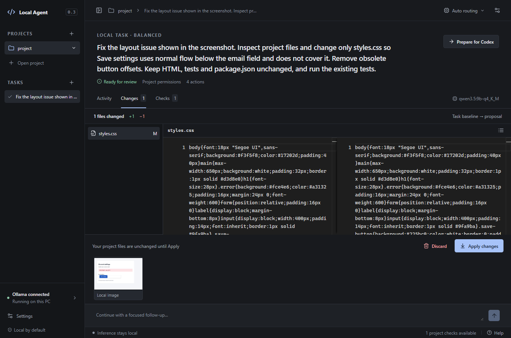

# Local Agent

A Windows desktop application for bounded coding tasks using models running on your own PC. Describe a task, inspect the agent's activity, review a diff, and explicitly apply or undo the changes.

Built with Tauri 2, React, TypeScript and Rust. Inference uses Ollama's local API. This is an early, Windows-first developer tool for repetitive work; difficult tasks can be packaged for a cloud coding agent without uploading anything automatically.

[Download Windows installer](https://github.com/Guardianec/local-agent/releases/latest) В· [Architecture](ARCHITECTURE.md) В· [Changelog](CHANGELOG.md) В· [Development history](docs/DEVELOPMENT_HISTORY.md) В· [Contributing](CONTRIBUTING.md)

## What it does

- Read/search a project, propose edits, and run explicitly approved test/lint/build recipes.
- Keep originals untouched in a separate task copy until you review and apply changes.
- Show diffs, actual check results, permission requests and an activity timeline.
- Restore applied changes with conflict-aware Undo, including projects with pre-existing edits.
- Route work between three local tiers and continue an investigation when a stronger model is needed.
- Accept screenshots through a picker, paste or drag-and-drop, with previews and removal.
- Produce an offline **Prepare for Codex** package with selected findings, checks and changes.
- Run deterministic search/checks without loading a model.
- Optionally run bounded Playwright scenarios against an explicitly approved origin, without personal browser profiles.



Actual native app review of a disposable synthetic project: local image input, a Balanced model proposal, check evidence and explicit Apply. No personal repository or credentials are shown. See the [acceptance report](docs/ACCEPTANCE.md).

## Local models

Default identities are centralized in [`assets/model-registry.json`](assets/model-registry.json). Installed metadata and compatibility checks determine actual capabilities; advanced users can assign other local models.

| Tier | Default Ollama model | Starting context | Intended use |
|---|---|---:|---|
| Fast | `qwen3.5:4b-q8_0` | 16K | Simple edits, summaries, lightweight images, repetitive work |
| Balanced | `qwen3.5:9b-q4_K_M` | 32K | Everyday coding, debugging and bounded multi-file changes |
| Strong | `qwen3.6:35b-a3b-q4_K_M` | 32K | Confirmed final local attempt; GPU plus system RAM expected |

Fast explicitly uses Q8; there is no silent Q4 substitution. Approximate downloads are 5.2 GB, 6.6 GB and 23.9 GB. Models are not bundled with the installer. Downloads require consent, with progress/cancellation. Cleanup uses matching app-install receipts; ambiguous and unrelated models are preserved unless deliberately selected where applicable.

### Dynamic escalation

Auto uses deterministic scope/failure signals rather than asking a model to judge its own ability. Ordinary substantive coding work starts with Balanced. Repeated tool errors, stalled progress, failed validation or context pressure can move a task through Fast в†’ Balanced в†’ Strong.

A switch retains the same task, working copy, findings, checks, image references, permissions and remaining budgets. The previous app-owned model is released first. Strong needs a matching passing coding benchmark and confirmation. If local work cannot finish, **Prepare for Codex** retains the investigation. A manual tier sets the starting preference; automatic escalation can be disabled for new tasks.

### Vision and privacy

PNG, JPEG and WebP use actual local Ollama vision requests. Up to four images of 8 MiB each are accepted, subject to decoded-image bounds; large images are normalized/resized to a 2,048-pixel longest edge. Dense text may need cropping. Text-only models are rejected before image inference.

Task records contain opaque references; image blobs are encrypted with Windows DPAPI. Repository/image text is untrusted data, not authority. Images stay local during inference and survive local continuation. Handoff export omits image pixels and asks you to review/attach them separately if you choose to share them with a cloud agent.

## Safety and permissions

Rust owns tool validation, permissions, filesystem access and execution. The model cannot bypass those checks.

- **Ask before edits:** reading/search is automatic; concrete proposed edits require approval.
- **Project:** eligible edits in the private task copy are automatic. Original-project Apply stays explicit.
- Project-code execution always requires approval. Fixed recipes, constrained arguments, timeouts and Windows Job Objects bound execution; there is no unrestricted model shell.
- Canonical path checks and pinned Windows handles confine files. Protected credentials, symlink/junction escapes, destructive Git actions and unrestricted deletion are excluded.
- Recoverable baselines, durable journals and exact hashes protect Apply/Undo. Newer external edits cause a conflict, not silent overwrite. Dirty Git changes and the index are preserved.
- Iteration/tool/command/time/response/context budgets are bounded. Stop retains reviewable evidence.

**Approved tests/build scripts execute as your Windows account and can access files/network. They are not sandboxed.** Use repositories you trust and read approvals. Redaction is best effort; review exports before sharing. See [security boundaries](SECURITY.md).

## Requirements and hardware

- Windows x64 and Microsoft Edge WebView2. Other desktop platforms are unsupported in this release.
- [Ollama](https://ollama.com/download/windows) running locally at `127.0.0.1:11434`. No cloud account or paid model subscription is required.
- Node.js/npm or Python for corresponding project checks; Git for Git inspection. They are not needed merely to open the app.
- Disk space for selected models and retained task copies. Optional browser support has a separate explicit Chromium/component installation.

Reference hardware: RTX 4070 Super 12 GB, i5-12400F, 32 GB RAM. All defaults passed a small real coding fixture on Ollama 0.40.5. Strong used approximately 9.05 GiB GPU allocation plus system RAM, with 7.21 GiB minimum sampled free RAM. It is **not** expected to fit fully in 12 GB VRAM. These are observations, not memory guarantees or general quality rankings. See [measurements and digests](docs/MODEL_CALIBRATION.md).

Strong checks memory before loading and watches for sustained RAM pressure. Loading can take several minutes. Close competing inference/memory-heavy applications, reduce context and recalibrate, or use Balanced. Preexisting residency belonging to another Ollama client is preserved and can block loading.

## Install

1. Download `Local-Agent_0.3.0_x64-setup.exe` from the [v0.3.0 release](https://github.com/Guardianec/local-agent/releases/tag/v0.3.0).
2. Optionally compare SHA-256 with the release's `SHA256SUMS` to verify the download.
3. Run the per-user installer and open **Local Agent** from Start.
4. Install/open Ollama separately. In **Auto routing в†’ Local models**, install desired tiers, check tool compatibility and run **Test coding**. Enable Strong after its matching benchmark passes.

The installer is **unsigned**; Windows may display a publisher warning. Download only from this repository's releases. Close existing installations before upgrading and keep the same installation/data locations. Automatic updates are not configured.

## Basic usage

1. **Open project** and select a local project folder.
2. Leave the model on **Auto** and start with **Ask before edits**.
3. Describe a bounded task, such as “Fix the addition function and run the existing tests.” Attach a screenshot if useful.
4. Watch **Activity**, approve intended actions, and inspect **Checks** and **Changes**.
5. **Apply changes** copies the reviewed proposal into the project. **Undo applied changes** restores captured bytes if affected files have not since changed.
6. If work stalls, **Prepare for Codex**, review the export and share it deliberately in your cloud tool.

See [Troubleshooting](docs/TROUBLESHOOTING.md) for setup, memory and image errors.

## Development

Use Windows, Node.js 20.19+ (22 tested), Rust MSVC (1.99.1 tested), Visual Studio C++ desktop tools/Windows SDK and WebView2. The manifest declares Rust 1.88 minimum; the complete locked dependency set was verified on 1.99.1.

```powershell
npm ci
npm ci --prefix browser-helper
npm run desktop
```

Native Tauri IPC is required; ordinary browser preview has no project authority. The browser helper's package version is independent of the desktop application.

```powershell
npm test
cargo test --manifest-path src-tauri/Cargo.toml
cargo fmt --manifest-path src-tauri/Cargo.toml --check
cargo clippy --manifest-path src-tauri/Cargo.toml --all-targets -- -D warnings
npm run build
```

Browser integration tests need matching Chromium. Setup, isolated UI testing and releases are documented in [CONTRIBUTING.md](CONTRIBUTING.md). Build public installers from a clean commit with `powershell -File scripts/build-release.ps1`; it runs checks, remaps build paths and invokes the real Tauri/NSIS pipeline. Plain `npm run package` remains a local build command, not the public-release procedure.

## Current limitations

- Early 0.x release; Windows x64 only, unsigned installer, no automatic updates.
- Models can make incorrect edits/misinterpret images. Strong is slower and needs substantial available RAM.
- Approved project code runs on the host. Browser request restrictions are not an OS egress firewall.
- No unrestricted shell, dependency-installation tool, personal authenticated-browser automation or automatic cloud upload.
- No automatic task/image/recovery pruning or full history paging UI. Empty directories can remain after Undo.
- Small-fixture benchmarks and targeted recovery tests are not exhaustive adversarial, crash, accessibility or multi-hour stress tests.

## Roadmap

Planned, not shipped:

- Signed Windows releases and a tested update mechanism.
- Retention controls, history browsing and export ergonomics.
- Broader reproducible model/stack evaluations.
- Symbol-aware retrieval when evidence justifies the added complexity.
- Accessibility coverage and clearer memory/model diagnostics.

## Contributing and license

Read [CONTRIBUTING.md](CONTRIBUTING.md) for setup and release obligations. [AGENTS.md](AGENTS.md) records maintenance rules for coding agents. Significant decisions belong in [DECISIONS.md](DECISIONS.md) and `docs/decisions/`. Report vulnerabilities privately through [SECURITY.md](SECURITY.md); never post private task exports or credentials.

Licensed under [MIT](LICENSE). Dependencies and separately downloaded runtimes/models retain their own licenses; see [THIRD_PARTY_NOTICES.md](THIRD_PARTY_NOTICES.md).
